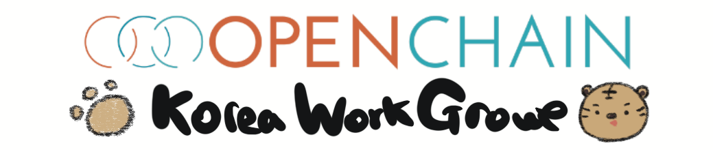

# OpenChain Korea Work Group

Welcome to OpenChain KWG!

## Intro

OpenChain KWG (Korea Work Group), a subgroup of the Linux Foundation [OpenChain Project](https://www.openchainproject.org/), aims to create and share ways to effectively achieve open source compliance for all Korean ICT companies using open source software through collaboration and sharing, which is the spirit of open source! : [About](https://korea-wg.openchainproject.org/about/)

## Subscribe

OpenChain KWG is always open.

Anyone in charge of Open Source Compliance at a Korean company or institute that develops and distributes software can participate. Join the Mailing List! :  [Subscribe](https://korea-wg.openchainproject.org/about/subscribe/)

## Contributing

OpenChain KWG always welcomes your contributions. We develop and grow with each and every precious contribution. Please refer to the next page for how to contribute. :  [CONTRIBUTING](CONTRIBUTING.md)

* GitHub Repository for cooperation : https://github.com/OpenChain-KWG
* New Meeting Page Guide : [CONTRIBUTING](CONTRIBUTING.md#새-미팅-페이지-생성-방법)

## License

* License for website code : [Apache-2.0](./LICENSE)
* License for documentation : [CC0 1.0](https://creativecommons.org/publicdomain/zero/1.0/), unless a page states otherwise (pages marked CC BY 4.0 remain under CC BY 4.0)

## Contact

If you have any inquiries/requests to OpenChain KWG, please contact us through the Mailing List. : [Contact](https://korea-wg.openchainproject.org/about/contact/)  

## License

Unless otherwise noted, all materials in this repository—and all new content published on or after **November 12, 2026**—are dedicated to the public domain under **[CC0 1.0 Universal](LICENSES/CC0-1.0.txt)**.

The following legacy guides, third-party translations, and pre-November 12, 2026 blog posts remain licensed under **[CC BY 4.0](LICENSES/CC-BY-4.0.txt)** (see [`REUSE.toml`](REUSE.toml) for machine-readable path mappings):

- **Guides** (including all sub-pages): `iso5230_guide`, `iso18974_guide`, `opensource_for_enterprise`, `finance-oss-guide`, `iso42001_guide`, `ai-sbom_guide`, `templates`, `tools`, `training-slides`, and `archive/governance_iso5230`
- **Resources (Korean translations)**: `resource/sbom_work_group/sbom_guide` and `resource/telco_work_group/telco_sbom`
- **Blog posts**: All 31 blog posts published prior to November 12, 2026
