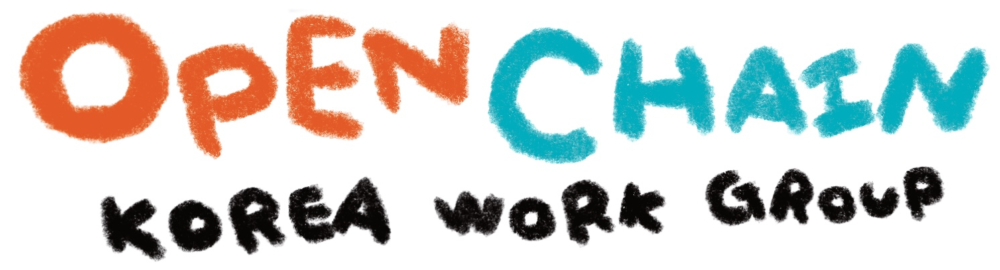

---
title: "About"
linkTitle: "About"
weight: 10
type: docs
description: >
  Introducing the OpenChain Korea Work Group.
menu:
  main:
    weight: 10
---

_
 < designed by [@soimkim](https://github.com/soimkim) > 
_

The OpenChain KWG (Korea Work Group), a subgroup of the Linux Foundation [OpenChain Project](https://openchainproject.org/), is a group to create and share how to effectively achieve open source compliance for everyone through collaboration and sharing, the spirit of open source software!

## Why we meet

Even if large companies have already established policies and processes for Open Source Compliance, considering the huge and complex software supply chain, it is difficult to escape from compliance risks, no matter how well-completed processes are in place. After all, it is important to increase the level of compliance for all companies in the software supply chain. To do this, companies that already have a good understanding of Open Source Compliance should share their assets and guide them so that other companies can easily participate.

Even if a company's Open Source Compliance assets are shared with competitors, it does not adversely affect sales. Conversely, finding out a competitor's Open Source Compliance policy cannot link it to an increase in corporate profits. If companies share best practices for Open Source Compliance with each other, each company can achieve significant levels of compliance with little cost and resources.

Some Korean companies also shared the same idea, and in January 2019, the first OpenChain KWG (Korea Work Group) meeting was held in which open source people from LG Electronics, SK Telecom, Kakao, Hyundai Motors, and Samsung Electronics participated.

## What we do

- [Regular meetings](../meeting/): Every quarter, a member company hosts a meeting where companies present their open source management cases and experience.
- [Guides](../guide/): We publish guides on putting international standards such as ISO/IEC 5230 and ISO/IEC 18974 into practice.
- [Resources](../resource/): We translate OpenChain Project specifications and materials into Korean.
- [Subgroups](../subgroup/): The steering committee and topic groups carry on more focused work.

## How to join

1. Join the [mailing list](subscribe/). Anyone working on open source compliance is welcome.
2. Receive meeting announcements and registration details by email, and attend the meetings.
3. Once you are a member, you can talk with other members on [Discord](https://discord.com/channels/1177116701561729104/).

If you are new, start with the [Welcome Package](welcomepackage/).
