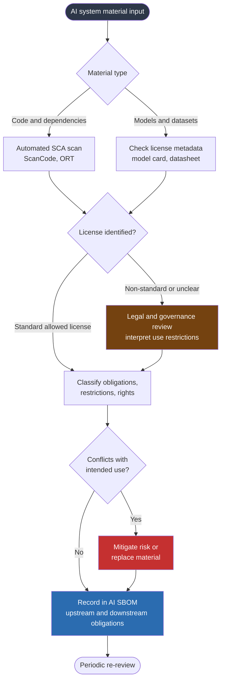

{}
This clause is implemented in **Phase 2: AI Extension Processes**.
[View the full implementation roadmap](../../#phased-implementation-roadmap)
{}

## 1. Clause Overview

License obligations are where the AI SBOM guide extends ISO/IEC 5230 the most. Whereas traditional open
source compliance reviewed the licenses of code, in AI the review targets grow to four: the AI system's
code, model weights, datasets (including training, testing, and verification datasets), and the license of
the AI system itself. Because it is common for one model to be derived from several other models, each
upstream model in the Model Tree has its own license.

3.5 requires a procedure for reviewing these licenses and determining the obligations, restrictions, and
rights that each license grants, in light of the intended use of the AI system. The review covers both the
obligations inherited from upstream and the obligations passed on downstream.

## 2. What to Do

- Establish a procedure for identifying the licenses of code, weights, datasets, and the AI system itself.
- Track the license of each upstream model in the Model Tree, and document the obligations, restrictions, and rights of each license.
- Use automated scanning tools for the first identification of source code and dependencies. *([Guide recommendation])*
- Judge model weights, datasets, and non-standard licenses through legal or governance review. *([Guide recommendation])*
- Have an intake procedure that requires license metadata to be received along with any model or dataset brought in from outside.
  *([Guide recommendation])*
- Record the review results (obligations, restrictions, rights) in the AI SBOM and track them.

## 3. Requirements and Verification Materials

| Clause | Requirement | Verification Material(s) |
|-----------|--------------|---------|
| 3.5 | A procedure shall exist for reviewing the licenses of an AI system's code, weights, and datasets, as well as the license of the AI system itself, to determine the obligations, restrictions, and rights granted by each license, taking into account the intended use. Note that the upstream models in the Model Tree may each have their own license. | **3.5.1** A documented procedure to review and document, as appropriate, the upstream and downstream obligations, restrictions, and rights granted by each identified license |

<details><summary>View the original text</summary>

> **3.5 License obligations**
> A process shall exist for reviewing the relevant identified licenses for an AI system's code,
> weights, and datasets (including but not limited to training, testing, and verification datasets)
> as well as the license for the AI system itself to determine the obligations, restrictions, and
> rights granted by each license, taking into account the intended use of the AI system. Note that
> it's often the case that an AI system is trained on multiple other AI systems that may be
> identified in the AI system Model Tree for example; each of these may have their own licenses.
>
> **Verification material(s):**
> - A documented procedure to review and document upstream and downstream obligations,
>   restrictions, and rights granted by each identified license, as appropriate.

</details>

## 4. How to Comply and Samples by Verification Material

### 3.5.1 Procedure for Reviewing and Documenting License Obligations

**How to Comply**

Design the review procedure on the premise that the level of automation differs by material type. Source
code and dependency licenses can be identified to a large extent with automated scanning tools such as
FOSSology, ScanCode, and OSS Review Toolkit. However, the licenses of model weights and datasets, and the
derivation relationships in the Model Tree, are outside the coverage of these tools or are identified with
low accuracy. Restrictions on the purpose of use in non-standard licenses require human interpretation.
A practical division of work is therefore to do the first identification with automated scanning and to
pass models, datasets, and non-standard licenses to legal or governance review.

The figure below shows the decision flow for determining license obligations when materials come in.



**Figure 1.** Decision flow for reviewing license obligations

**Considerations**

- **Enforce metadata at the intake gate**: The biggest cause of missed license obligations is license drift,
  in which provenance and license information is lost as a model is passed downstream. One study reports
  that a large share of restrictive clauses disappear in the transition from model to application
  ([arXiv:2509.09873](https://arxiv.org/abs/2509.09873)). Rather than trying to restore the information
  downstream, it is more effective to block intake of materials without license metadata at the internal
  model and dataset registry. *([Guide recommendation])*
- **Decide on non-standard licenses in advance through policy**: Compliance with the behavioral use
  restrictions of the Llama Community License or the OpenRAIL family is difficult to track automatically
  after the fact. Decide at the time of intake using the allowed and prohibited lists in
  [3.1 Policy](../../1-program-foundation/1-policy/). *([Guide recommendation])*
- **Track the Model Tree**: Check through the model card which upstream models the incoming model was
  derived from, and review whether the license obligations of upstream models are passed downstream.
- **Check dataset use restrictions**: Check whether datasets under non-commercial licenses such as
  CC-BY-NC were used to train commercial products. Missing and incorrect dataset licenses are common, so
  compare against the license text.
- **Recognize the limits of automation**: Do not treat the output of automated scanning tools as the final
  judgment. Tools help with identification, and people handle interpreting obligations and judging conflicts.

**Sample**

Below is a sample of the core part of a license obligation review procedure. This procedure document becomes verification material 3.5.1.

```
## AI License Obligation Review Procedure

### 1. Review targets
- AI system code and dependencies
- Model weights (models brought in, fine-tuned models)
- Datasets (training, testing, verification)
- Licenses of upstream models in the Model Tree

### 2. Review steps
1) Automated identification: Scan the licenses of code and dependencies with an SCA tool.
2) Metadata collection: Collect the licenses of models and datasets from model cards and datasheets.
   If metadata is missing, put the intake on hold.
3) Classification: Compare the identified licenses against the policy's allowed, conditional, and prohibited lists.
4) Legal review: For non-standard or unclear licenses, interpret the obligations through legal and governance review.
5) Recording: Record upstream and downstream obligations, restrictions, and rights in the AI SBOM.

### 3. Responsibilities and frequency
- First identification: development owner
- Interpretation of obligations: legal and AI governance lead
- Re-review: when a model or dataset is replaced, and at least once a quarter
```

## 5. References

- Allowed and prohibited license list policy: [3.1 Policy](../../1-program-foundation/1-policy/)
- AI SBOM in which to record review results: [3.9 AI SBOM](../3-ai-sbom/)
- Automated scanning tools: [Tools: FOSSology](../../../tools/1-fossology/), [SCANOSS](../../../tools/9-scanoss/)
- AI model and dataset license strategy: [Enterprise Open Source Management Guide: AI Compliance](../../../opensource_for_enterprise/7-ai-compliance/)
