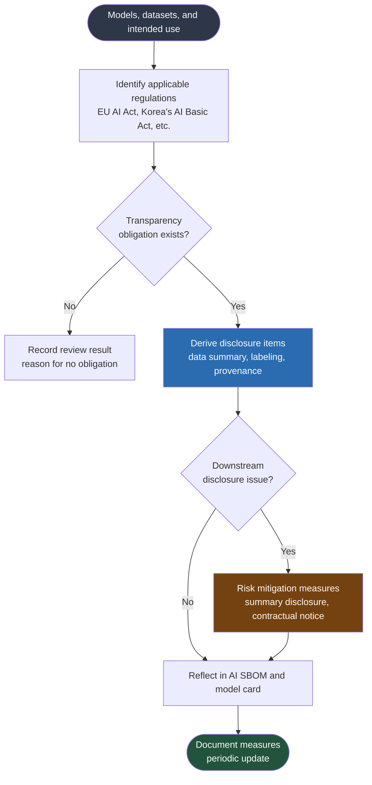

{}
This clause is implemented in **Phase 2: AI Extension Processes**.
[View the full implementation roadmap](../../#phased-implementation-roadmap)
{}

## 1. Clause Overview

If license obligations (3.5) ask "do we have the right to use this material," transparency obligations ask
"what must we disclose about this material." The two obligations come from different sources. License
obligations are imposed by copyright holders through contract, and transparency obligations are imposed by
regulations through law.

3.6 requires a procedure for reviewing whether there are transparency obligations imposed by regulations.
The review covers training, testing, and verification datasets and takes into account the intended use of
the model. If the use case for the training data creates a transparency issue (e.g., disclosure obligations
to downstream recipients), appropriate risk mitigation measures must be taken. As the EU AI Act begins to
fully apply its transparency obligations from August 2026, this clause is becoming more important in practice.

## 2. What to Do

- Have a procedure for identifying the transparency regulations that apply to the AI systems you bring in or develop.
- Review, based on the intended use, whether disclosure obligations apply to training, testing, and verification datasets.
- If there are disclosure obligations to downstream recipients, decide on risk mitigation measures.
- Document the transparency measures taken.
- Periodically update and reflect the latest transparency obligations set by regulators. *([Guide recommendation])*

## 3. Requirements and Verification Materials

| Clause | Requirement | Verification Material(s) |
|-----------|--------------|---------|
| 3.6 | A procedure shall exist for reviewing whether there are transparency obligations imposed by regulations, including for training, testing, and verification datasets, taking into account the intended use of the model. If there is a transparency issue (e.g., downstream disclosure obligations), risk mitigation measures should be taken. | **3.6.1** A documented procedure to review and document the transparency measures undertaken |

<details><summary>View the original text</summary>

> **3.6 Transparency obligations**
> A process shall exist for reviewing if there are any transparency obligations from regulations
> including but not limited to training, testing, and verification datasets, taking into account the
> intended use of the model. If the use case for the training data creates a relevant issue (e.g.,
> disclosure obligations to downstream recipients) in the context of transparency, then appropriate
> risk mitigation measures should be undertaken.
>
> **Verification material(s):**
> - A documented procedure to review and document the transparency measures undertaken.

</details>

## 4. How to Comply and Samples by Verification Material

### 3.6.1 Procedure for Reviewing and Documenting Transparency Obligations

**How to Comply**

Because transparency obligations differ by regulation, start by identifying which regulations apply. Once the
applicable regulations are determined, derive the disclosure items each regulation requires, and reflect those
items in the AI SBOM or model card. Unlike license obligations, transparency obligations center on
"disclosure," so the deliverables must be organized in a form that can be delivered externally.

The table below lists the main transparency obligations that intersect with the AI SBOM. The regulatory
timeline and overall context are managed together in the regulatory matrix in
[3.10 Governance](../../4-governance/1-governance/).

**Table 1.** Transparency obligations that intersect with the AI SBOM (as of 2026-06)

| Source | Transparency obligation | Reflected in the AI SBOM and model card |
|---|---|---|
| EU AI Act Article 53 (GPAI) | Publishing a summary of training data, respecting copyright opt-outs | Dataset provenance and license, records of opt-out handling |
| EU AI Act Article 50 | Labeling AI-generated content, notice of interaction with AI | Output labeling policy |
| Korea's AI Basic Act (AI 기본법) | Labeling obligations for high-impact and generative AI, disclosure of training data provenance | Labeling and provenance items in the model card |
| Notices required by licenses | "Built with Llama" notice, stating the derived model name, etc. | Tracked together with license obligations (3.5) |

The following figure shows the review flow for deriving transparency obligations from the intended use of the material.



**Figure 1.** Transparency obligation review flow

**Considerations**

- **Dataset provenance is central**: Many transparency obligations apply to training data. Disclosure
  obligations can be fulfilled only if the provenance and license of datasets are recorded in the AI SBOM.
  This connects directly to the AI SBOM (3.9).
- **Intended use is the criterion**: Even for the same model, transparency obligations differ by use case.
  High-risk uses and services for the general public carry heavier obligations.
- **Downstream disclosure obligations**: When supplying a model or system externally, review whether there is
  information that must be given to the recipient. Risk mitigation can be carried out by publishing a summary
  of training data or through contractual notice.
- **Reflect regulatory changes**: The EU AI Act applies transparency obligations from August 2026, so update
  the procedure in line with that timing. Responsibility for updates is managed by governance (3.10).

**Sample (Transparency Obligation Review Procedure)**

Below is a sample of the core part of a transparency obligation review procedure. This procedure document becomes verification material 3.6.1.

```
## Transparency Obligation Review Procedure

### 1. Identify applicable regulations
Identify the applicable regulations based on the intended use and deployment region of the AI system.
(e.g., deployment in the EU market: EU AI Act; high-impact AI in Korea: Korea's AI Basic Act)

### 2. Derive disclosure items
Organize the transparency obligations of each regulation into disclosure items.
- Summary of training data (EU AI Act Article 53)
- Labeling of AI generation and interaction (EU AI Act Article 50, Korea's AI Basic Act)
- Disclosure of data provenance (Korea's AI Basic Act)

### 3. Downstream review
When supplying externally, review the information to be delivered to recipients, and decide on the necessary risk mitigation measures.

### 4. Reflection and documentation
Reflect the derived disclosure items in the AI SBOM and model card, and record the measures taken.

### 5. Responsibilities and frequency
- Review: legal and AI governance lead
- Update: when the regulatory enforcement timeline changes, and at least once every six months
```

## 5. References

- Distinction from license obligations: [3.5 License obligations](../1-license-obligations/)
- AI SBOM that holds the disclosure items: [3.9 AI SBOM](../3-ai-sbom/)
- Regulatory timeline and governance: [3.10 Governance](../../4-governance/1-governance/)
- AI model licenses and labeling obligations: [Enterprise Open Source Management Guide: AI Compliance](../../../opensource_for_enterprise/7-ai-compliance/)
