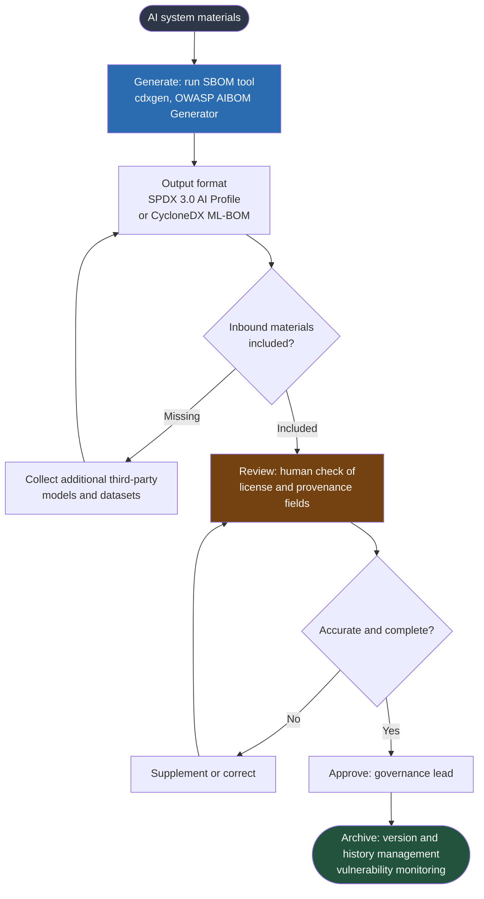

{}
This clause is implemented in **Phase 2: AI Extension Processes**.
[View the full implementation roadmap](../../#phased-implementation-roadmap)
{}

## 1. Clause Overview

An AI SBOM (AI System Bill of Materials) is a list of the components that make up an AI system and
information about them. Whereas a traditional SBOM records software components, an AI SBOM adds models,
weights, datasets, and hyperparameters. 3.9 requires a procedure for creating and managing an AI SBOM.

The format is not fixed. The specification states that any format, such as SPDX, CycloneDX, or another
format, is acceptable. There is, however, one obligation. The AI SBOM shall account for inbound materials
from third parties. If pre-trained models and datasets brought in from outside are missing, there is no
basis for tracking license obligations ([3.5](../1-license-obligations/)) and transparency obligations.

The AI SBOM area is where the boundary "generation is automated by tools, but accuracy and compliance
judgments are filled in by people" is most visible. This page explains the procedure along that boundary.

## 2. What to Do

- Establish a procedure for identifying, tracking, reviewing, approving, and archiving the components of an AI system (models, datasets, etc.).
- Decide on an AI SBOM format (SPDX 3.0 AI Profile or CycloneDX ML-BOM recommended). *([Guide recommendation])*
- Always include models and datasets coming in from third parties in the AI SBOM.
- Integrate generation tools with CI/CD to generate the AI SBOM repeatedly. *([Guide recommendation])*
- Have people review whether the license and provenance fields of the generated AI SBOM are accurate. *([Guide recommendation])*
- Retain records that demonstrate the procedure was followed (generation history, approval history).

## 3. Requirements and Verification Materials

| Clause | Requirement | Verification Material(s) |
|-----------|--------------|---------|
| 3.9 | A procedure shall exist for creating and managing an AI SBOM. Any format, such as SPDX or CycloneDX, is acceptable. The AI SBOM shall account for inbound materials from third parties. | **3.9.1** A documented procedure for identifying, tracking, reviewing, approving, and archiving information related to the components of an AI system (models, datasets, etc.)<br>**3.9.2** Records for the supplied system that demonstrate the procedure was properly followed |

<details><summary>View the original text</summary>

> **3.9 AI System Bill of Materials**
> A process shall exist for creating and managing an AI SBOM, this can be in any format e.g. SPDX,
> CycloneDX, or another format. The AI SBOM shall account for inbound materials from third-parties.
>
> **Verification material(s):**
> - A documented procedure for identifying, tracking, reviewing, approving, and archiving
>   information related to the components of an AI system (e.g., model, datasets, etc).
> - Records for the supplied system that demonstrates the documented procedure was properly followed.

</details>

## 4. How to Comply and Samples by Verification Material

### 3.9.1 AI SBOM Management Procedure (Identifying, Tracking, Reviewing, Approving, Archiving)

**How to Comply**

Design the AI SBOM procedure in four stages: generation, review, approval, and archiving. Automate the
generation stage with tools, and have people handle the review and approval stages. Even if a tool copies
the license field of a model card as is, the tool cannot judge whether that license fits the actual use
case or whether anything is missing or incorrectly stated.

The figure below shows the flow from AI SBOM generation to archiving.



**Figure 1.** Procedure from AI SBOM generation to archiving

**Tool Mapping**

These are open source tools that can be used at each stage. "Automation level" indicates how much of the
task a tool can take over.

| Stage | Task | Automation Level | Representative Tools |
|------|------|------------|-----------|
| Generation | Code and dependency BOM | Mature | cdxgen, Syft |
| Generation | Model and metadata AIBOM | Tools emerging | OWASP AIBOM Generator, cdxgen `aibom` |
| Analysis | Static inspection of model binaries | Tools emerging | Lab700x AI SBOM Scanner |
| Management | SBOM storage and vulnerability monitoring | Mature | Dependency-Track, SW360 |
| Review | Judging license and provenance accuracy | People and policy | Tools at a supplementary stage |

Installation, usage, and screenshots of each tool are covered in detail in the [Tools](../../5-tools/) section ([OWASP AIBOM
Generator](../../5-tools/1-aibom-generator/), [cdxgen](../../5-tools/2-cdxgen/),
[Model and container scanners](../../5-tools/3-scanners/)).

The commands to generate an AI BOM with cdxgen are as follows. Hugging Face model URLs and purls, Modelfiles,
and GGUF artifacts can be given directly as input ([cdxgen AI-BOM documentation](https://github.com/cdxgen/cdxgen/blob/master/docs/AI_BOM.md)).

```bash
# Generate an AI BOM in the AI project directory
cdxgen -t ai -o aibom.json .

# Generate including AI/ML metadata (formulation)
cdxgen -t ai --include-formulation -o aibom.json .
```

OWASP AIBOM Generator takes a Hugging Face model as input, creates an AIBOM in CycloneDX format, and gives it a
completeness score. It is maintained by the OWASP Gen AI Security Project and is also available as a Hugging Face Space
([OWASP AIBOM Generator](https://genai.owasp.org/resource/owasp-aibom-generator/)).

**Hands-on: Generating with cdxgen**

This is the result of actually running cdxgen on a summarization app (depending on `transformers` and `torch`)
that loads a pre-trained model (`facebook/bart-large-cnn`). The tool automatically identifies 5 dependencies
and creates a BOM in CycloneDX 1.7 format.

```text
$ cdxgen -t python --include-formulation -o aibom.json .
CycloneDX Generator 12.5.1 (Node.js)

Generated components: 5 (CycloneDX 1.7):
  transformers     4.44.2    pkg:pypi/transformers@4.44.2      license: empty
  torch            2.4.0     pkg:pypi/torch@2.4.0             license: empty
  numpy            1.26.4    pkg:pypi/numpy@1.26.4            license: empty
  tokenizers       0.19.1    pkg:pypi/tokenizers@0.19.1       license: empty
  huggingface-hub  0.24.6    pkg:pypi/huggingface-hub@0.24.6   license: empty
```

One component of the generated BOM is shown below. The identification basis (evidence) is filled in, but the
`licenses` field is empty.

```json
{
  "name": "transformers",
  "version": "4.44.2",
  "purl": "pkg:pypi/transformers@4.44.2",
  "type": "library",
  "evidence": {
    "identity": [
      { "field": "purl", "confidence": 0.5,
        "methods": [{ "technique": "manifest-analysis", "value": "requirements.txt" }] }
    ]
  }
}
```

**Figure 2.** cdxgen 12.5.1 output *(run on 2026-06-13, `-t python --include-formulation`)*

{}
- The tool automatically identified 5 dependencies from `requirements.txt` and created a BOM. Generation is automated.
- However, the `licenses` field of each component is empty. License accuracy must be checked and filled in by people.
- The pre-trained model `facebook/bart-large-cnn` that the app loads was not captured in the BOM by code scanning
  alone. It must be collected separately as an inbound material and added (see Considerations below).

The boundary described in this section, "generation by tools, accuracy and completeness by people," appears
exactly as is in the actual tool output.
{}

**Format Sample (CycloneDX ML-BOM)**

Below is a shortened example of the model component structure of a CycloneDX 1.6 ML-BOM. The key structure
follows the `machine-learning-model` component and `modelCard` in the
[official CycloneDX specification](https://cyclonedx.org/capabilities/mlbom/). If the license is non-standard
(has no SPDX ID), write it as `name`.

```json
{
  "bomFormat": "CycloneDX",
  "specVersion": "1.6",
  "components": [
    {
      "bom-ref": "model-llama31-8b",
      "type": "machine-learning-model",
      "group": "meta-llama",
      "name": "Llama-3.1-8B",
      "version": "1.0",
      "licenses": [
        { "license": { "name": "Llama 3.1 Community License" } }
      ],
      "modelCard": {
        "modelParameters": {
          "task": "text-generation",
          "architectureFamily": "llama",
          "datasets": [
            { "type": "dataset", "name": "Public pre-training corpus", "classification": "public" }
          ]
        },
        "considerations": {
          "useCases": ["Summarizing internal documents"],
          "technicalLimitations": ["Possibility of hallucination", "Variation in Korean language performance"]
        }
      }
    }
  ]
}
```

If you use SPDX 3.0, the AI Profile and Dataset Profile express the same information
([SPDX 3.0 AI Profile](https://spdx.github.io/spdx-spec/v3.0.1/model/AI/AI/)). The specific fields of the
formats and the technical details of generation tools are covered in [ISO/IEC 42001 Guide: AI SBOM](../../../iso42001_guide/4-operation/2-ai-sbom/).

**Considerations**

- **Account for inbound materials (specification obligation)**: Have a procedure that creates SBOM entries at
  the time of intake so that models and datasets brought in from outside are not left out of the AI SBOM. This is a `shall`-level obligation.
- **Generation by tools, review by people**: Generation tools copy the license written in the model card as is.
  Because licenses are often missing or incorrectly stated in the model card itself, have people review the
  license and provenance fields of the generated AI SBOM against the original sources.
- **Format consistency**: Choose either SPDX or CycloneDX as the default format within the organization, and
  operate tools and repositories consistently. Both formats treat models and datasets as first-class components.
- **CI/CD integration**: An AI SBOM is not a deliverable that is created once and finished. Integrate it with
  the pipeline so that it is regenerated whenever a model or dataset changes.

### 3.9.2 Records Demonstrating That the Procedure Was Followed

**How to Comply**

Verification material 3.9.2 is the record showing that the procedure was actually followed. Along with the AI
SBOM file itself, keep a history of when and by whom it was generated, reviewed, and approved. If it is generated
automatically in CI/CD, the build logs and the generated SBOM artifacts serve as records, and the history of
uploads to a management tool such as Dependency-Track also serves as evidence.

**Considerations**

- **Preserve generation history**: For each version of a supplied AI system, archive the AI SBOM at that point in time to ensure traceability.
- **Approval records**: Record who carried out the review and approval. This connects to the lifecycle review in
  [Governance (3.10)](../../4-governance/1-governance/).

## 5. References

- License obligation review procedure: [3.5 License obligations](../1-license-obligations/)
- Technical details of AI SBOM formats and generation tools: [ISO/IEC 42001 Guide: AI SBOM](../../../iso42001_guide/4-operation/2-ai-sbom/)
- SBOM management tools: [Dependency-Track](../../../tools/7-dependency-track/), [cdxgen + Dependency-Track integration](../../../tools/8-cdxgen-dt/)
- Governance and lifecycle review: [3.10 Governance](../../4-governance/1-governance/)
