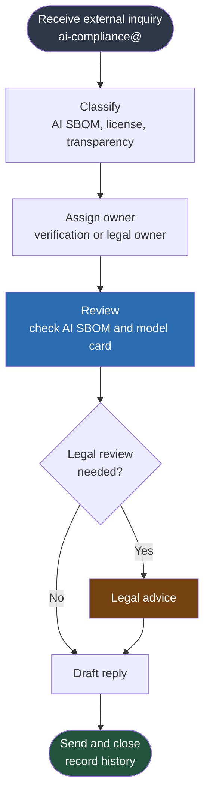

{}
This clause is implemented in **Phase 3: Operating Structure**.
[View the full implementation roadmap](../../#phased-implementation-roadmap)
{}

## 1. Clause Overview

Organizations that exchange AI systems in the supply chain need to confirm each other's compliance. For that, a channel for external inquiries must be publicly available, and the organization must be ready to respond to those inquiries. Access ensures both directions.

3.7 requires two things: publicly identifying a means by which a third party can make an AI SBOM compliance inquiry, and maintaining an internal process to respond effectively to those inquiries. For AI, inquiries also cover AI-specific information such as model and dataset licenses, training data provenance, and model cards.

## 2. What to Do

- Publish a means (e.g., a public email address) by which third parties can make AI SBOM compliance inquiries.
- Post the public means where it can be found externally, such as product notices or the website.
- Document the internal procedure for receiving, classifying, and responding to external inquiries.
- Set the response owner and handling deadlines.
- Record inquiries and responses.

## 3. Requirements and Verification Materials

| Clause | Requirement | Verification Material(s) |
|-----------|--------------|---------|
| 3.7 | Maintain a process to respond effectively to external AI SBOM compliance inquiries, and publicly identify a means by which third parties can make inquiries. | **3.7.1** Publicly available method that allows interested parties to make an AI SBOM compliance inquiry (e.g., a public contact email)<br>**3.7.2** Internal documented procedure for responding to third-party AI SBOM compliance inquiries |

<details><summary>View original English text</summary>

> **3.7 Access**
> Maintain a process to effectively respond to external AI SBOM Compliance inquiries. Publicly
> identify a means by which a third party can make an AI SBOM Compliance inquiry.
>
> **Verification material(s):**
> - Publicly visible method that allows any interested parties to make an AI SBOM Compliance inquiry
>   (e.g., via a published contact email address).
> - An internal documented procedure for responding to third-party AI SBOM Compliance inquiries.

</details>

## 4. How to Comply and Samples by Verification Material

### 3.7.1 Public External Inquiry Channel

**How to Comply**

Identify a public contact method that anyone can find. A role-based email address (a job function address, not a personal one) is stable. Places to post it include product notices, the open source and AI policy page of the company website, and the contact section of the model card. Stating a response deadline along with it increases trust.

**Sample**

```
AI compliance inquiries: ai-compliance@company.com

We accept inquiries about the components, model and dataset licenses, and AI SBOMs
of the AI systems we provide. We send an initial reply within 14 business days of receipt.

(Posted at: product notices, company website AI policy page, model card contact section)
```

---

### 3.7.2 Internal Inquiry Response Procedure

**How to Comply**

Document the internal procedure from receiving an external inquiry to answering it. Define the steps of receipt, classification, assignment, review, reply, and recording, and set a deadline for each step. Because AI SBOM inquiries require referring to model cards and license review records, the AI SBOM verification owner and the license review owner respond together.

The figure below shows the external inquiry response flow.



**Figure 1.** Response flow for external AI SBOM compliance inquiries

**Considerations**

- **Set deadlines**: Set a deadline for the initial reply (e.g., 14 days) and for the final answer (e.g., 60 days).
- **Protect AI-specific information**: Set criteria for how much sensitive information, such as model weights or training data, to disclose when answering inquiries. Define the boundary between trade secrets and transparency obligations (3.6). *([Guide recommendation])*
- **Keep records**: Record the inquiry, the reply, and the handling period, and retain them as verification materials.

**Sample (response procedure outline)**

```
## AI SBOM Compliance Inquiry Response Procedure

1. Receipt: Register inquiries received at ai-compliance@.
2. Classification: Classify as AI SBOM request / license inquiry / transparency obligation inquiry.
3. Assignment: Based on the classification, assign to the AI SBOM verification owner or the license review owner.
4. Review and reply: Check the relevant AI SBOM and model card and reply. Sensitive information follows
   the disclosure criteria. Go through legal review if needed.
5. Recording: Retain the inquiry, reply, and handling period.

Deadlines: initial reply 14 days, final answer 60 days.
```

## 5. References

- Roles and resources of the response owner: [3.8 Effectively Resourced](../2-resourced/)
- AI SBOM used in replies: [3.9 AI SBOM](../../2-ai-extension/3-ai-sbom/)
- Disclosure scope and transparency obligations: [3.6 Transparency Obligations](../../2-ai-extension/2-transparency-obligations/)
- ISO/IEC 5230 example for external inquiries: [ISO/IEC 5230 Conformance Guide: 3.2.1 External Inquiry Response](../../../iso5230_guide/2-relevant-tasks/1-access/)
