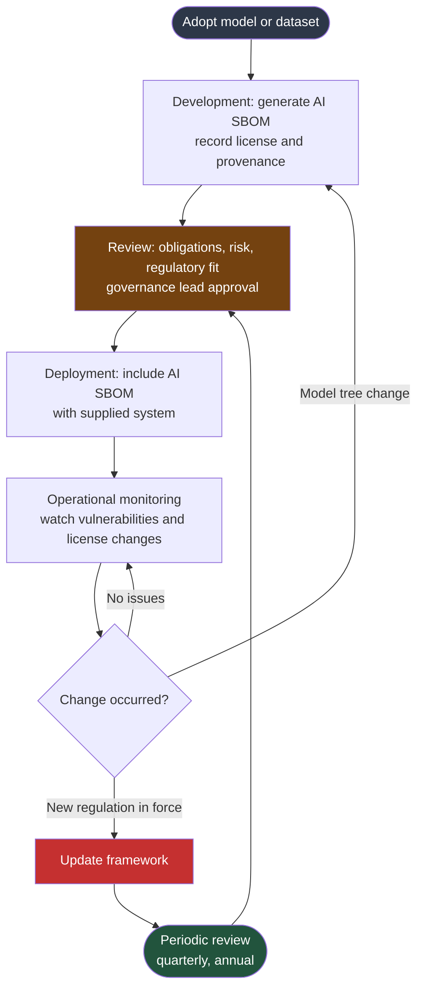

{}
This clause is implemented in **Phase 4: Governance**.
[View the full implementation roadmap](../../#phased-implementation-roadmap)
{}

## 1. Clause Overview

Governance is the framework that brings all the preceding clauses together and ensures responsible development, deployment, and management across the AI system lifecycle. If the policy (3.1) sets the principles and license obligations (3.5) and the AI SBOM (3.9) create individual processes, governance manages them so that they work consistently even as regulations change and models are replaced.

3.10 requires having an AI governance framework, policies, and practices. The specification emphasizes compliance with emerging AI laws and regulations such as the EU AI Act, the Hiroshima AI Process, and China's Global AI Governance Initiative, and addresses ethical considerations, risk management, and transparency together. The key point is to review the framework periodically once it is built, so that it reflects the latest regulations and model changes.

## 2. What to Do

- Write a governance framework document covering the entire AI system lifecycle.
- Include emerging AI regulation tracking, risk management, transparency, and ethical considerations in the framework.
- Have a procedure for reviewing and updating the framework periodically.
- Monitor the risks associated with ongoing use of AI systems and training data.
- Reflect events such as model tree changes, regulations taking effect, and changes in OSAID classification in governance. *([Guide recommendation])*

## 3. Requirements and Verification Materials

| Clause | Requirement | Verification Material(s) |
|-----------|--------------|---------|
| 3.10 | Have an AI governance framework, policies, and practices that ensure AI systems are developed, deployed, and managed responsibly. Emphasize compliance with emerging AI laws (EU AI Act, Hiroshima AI Process, China's initiative), and address ethical considerations, risk management, and transparency. | **3.10.1** Documented AI governance framework for the AI system lifecycle, including a procedure to review the framework periodically |

<details><summary>View original English text</summary>

> **3.10 Governance**
> An organization shall have a governance framework for AI, policies, and practices to help ensure
> that AI systems are developed, deployed, and managed responsibly. Governance emphasizes compliance
> with emerging AI laws and regulations, such as the EU AI Act, Hiroshima AI process or Global AI
> Governance Initiative (China), and addresses ethical considerations, risk management, and
> transparency. For example, understand the risks associated with ongoing use of AI Systems and
> training data in the context of their intended Programs. This could include the ability to monitor
> the lifecycle of the AI system and perform ongoing analysis of its intended uses.
>
> **Verification material(s):**
> - A documented AI governance framework for the lifecycle of an AI system with a process to review
>   the framework periodically.

</details>

## 4. How to Comply and Samples by Verification Material

### 3.10.1 AI Governance Framework and Periodic Review Procedure

**How to Comply**

A governance framework contains three parts: tracking emerging regulations to derive obligations, monitoring the AI system lifecycle, and a procedure for periodically reviewing the framework itself. Because regulations change quickly, the framework must not be a fixed document but a system that assumes ongoing updates.

The three initiatives named in the specification differ in nature. The EU AI Act imposes specific obligations article by article, the Hiroshima AI Process runs voluntary transparency reporting, and China's initiative is closer to a policy declaration. Governance distinguishes these differences and tracks each one accordingly.

The table below lists the main regulations to track from an AI SBOM perspective. The full regulatory matrix and the ISO/IEC 42001 context are covered in [ISO/IEC 42001 Guide: Context of the Organization and Leadership](../../../iso42001_guide/1-context-leadership/).

**Table 1.** Main AI regulations that intersect with AI SBOM (as of 2026-06)

| Regulation or initiative | Timing | Key obligations from an AI SBOM perspective | Reflection in governance |
|---|---|---|---|
| EU AI Act Article 11 + Annex IV | 2027 (high-risk) | Technical documentation obligation | Produce the AI SBOM as a core element of technical documentation |
| EU AI Act Article 53 (GPAI) | 2026-08 | Public summary of training data, respect for copyright opt-outs | Track dataset provenance and licenses |
| EU AI Act Article 50 | 2026-08 | Labeling of AI-generated content | Link with transparency obligations (3.6) |
| Hiroshima AI Process | Launched 2025, Reporting 2.0 (2026-05) | Voluntary transparency reporting | Consider participating in the OECD reporting framework |
| China Global AI Governance Initiative | Announced 2023 | Policy declaration (no specific deliverables) | Monitor developments |
| Korea AI Basic Act (AI 기본법) | In force 2026-01 | Impact assessment for high-impact AI, labeling obligations, disclosure of training data provenance | Prepare AI SBOMs and model cards |

Lifecycle monitoring means placing governance checkpoints along the flow from development to retirement. The figure below shows lifecycle governance built around the AI SBOM.



**Figure 1.** Lifecycle governance built around the AI SBOM

**Considerations**

- **Assign responsibility for regulation tracking**: State in the governance framework who tracks emerging regulations and derives obligations. Obligations under the EU AI Act expand in stages in August 2026 and in 2027, so manage the timing.
- **Manage model tree changes**: When an adopted model moves to a new version or an upstream model is replaced, license obligations may change. Register such changes as governance review events. *([Guide recommendation])*
- **Update OSAID classification**: The distinction between "open source AI" and "open weight" (OSAID 1.0) affects model license judgments. Include changes in classification criteria in the periodic review.
- **State review cycles**: Review model and dataset changes quarterly, and regulations and the framework as a whole annually. Record the review completion date and the reviewer.
- **Link with other clauses**: Governance ties together, at a higher level, the regulatory review in transparency obligations (3.6) and the lifecycle management in AI SBOM (3.9). Link them instead of creating duplicate procedures.

**Sample (governance framework and annual review plan)**

Below is a sample of the core parts of a governance framework document and periodic review plan. This document serves as verification material 3.10.1.

```
## AI Governance Framework

### 1. Scope and Purpose
Manage licenses, transparency, risk, and regulatory compliance across the entire lifecycle of AI systems:
adoption, development, deployment, operation, and retirement.

### 2. Governance Structure
- AI governance lead: approves the framework, makes final judgments on regulatory obligations
- Regulation tracking owner: monitors emerging AI regulations, derives obligations
- AI SBOM verification owner: operates the generation, review, and approval procedure
- Legal: interprets non-standard licenses and regulations

### 3. Periodic Review Plan
| Cycle | Review items | Owner | Deliverable |
|------|----------|------|--------|
| Quarterly | Model and dataset changes, model tree licenses | AI SBOM verification owner | Change review record |
| Semiannual | Non-standard license classification, OSAID updates | Legal | Updated classification |
| Annual | Regulation enforcement schedule, overall framework, policy consistency | AI governance lead | Revised framework |

### 4. Change Management
When a model tree change, a new regulation taking effect, or a license policy change occurs, convene an
ad hoc review without waiting for the periodic review. Record review results and actions in the change history.
```

## 5. References

- Policy basis: [3.1 Policy](../../1-program-foundation/1-policy/)
- Transparency obligations and regulatory review: [3.6 Transparency Obligations](../../2-ai-extension/2-transparency-obligations/)
- AI SBOM lifecycle management: [3.9 AI SBOM](../../2-ai-extension/3-ai-sbom/)
- Full regulatory matrix and ISO/IEC 42001 context: [ISO/IEC 42001 Guide: Context of the Organization and Leadership](../../../iso42001_guide/1-context-leadership/)
