{}
This guide covers the use and management of open source in the financial sector. Its starting point is the closed network.
Import, internal mirrors, and offline vulnerability management are prerequisites for every stage, including identification, use approval, and management,
so they are explained once here, and each stage page points to this page with an "Applying in a closed network" box.

Documents produced here: an import procedure and import approval records, and a self risk assessment for a network separation exception.
{}

## Why cover closed networks first?

Typical open source practice assumes an internet connection. Developers download dependencies with
package managers, query online vulnerability databases, and use cloud-based scanners. In the critical
business networks and core systems of financial institutions, this assumption does not hold. In an
environment where external communication is blocked, bringing in open source is itself subject to
control, and how to obtain vulnerability information becomes the first problem to solve.

The "Guide to Using and Managing Open Source Software in the Financial Sector" (금융분야 오픈소스
소프트웨어 활용·관리 안내서; Financial Supervisory Service (금융감독원) and Financial Security Institute
(금융보안원), 2022, hereafter the FSEC guide) sets out the management procedure
in four stages: identification, issue identification and resolution, use approval, and management. In a
closed network, however, there is a gate to pass before "identification": how the software will be
brought in. That is why this guide moves the closed network up to section 0.

{}
This guide is supplementary material that does not replace the FSEC guide, and its recommendations are
good practice, not legal obligations (see [Nature and scope in the overview](../)). Most of the closed
network procedures on this page are <strong>[Guide recommendation]</strong> items that the standards do
not directly require, and only the points that the standards or regulations directly require are marked
with their source as **[ISO requirement]** or <strong>[FSEC guide]</strong>.
{}

## Two realities to handle together

If you assume closed networks mean only "fixed physical network separation," the guide will soon be out
of date, because the regulatory environment is in transition. The Financial Services Commission
(금융위원회) announced the "Roadmap for Improving Network Separation in the Financial Sector" (금융분야
망분리 개선 로드맵) (2024-08-13), and amendments to the Regulation on Supervision of Electronic Financial
Transactions (전자금융감독규정) and its Enforcement Rules (시행세칙) then took effect on 2025-02-05. With
these amendments, regulation that had long centered on physical network separation began to shift
toward voluntary security and a risk-based approach. For research and development work that does not
process unique identification information or personal credit information, a financial institution can
apply a network separation exception after a self risk assessment, application of information
protection controls that substitute for network separation, and approval by the Information Protection
Committee (정보보호위원회). Other relaxations, such as expanding the use of cloud-based application
software (SaaS, Software as a Service) on internal business networks, are being pursued as later stages
of the roadmap.

Practitioners in the financial sector therefore work with two realities at the same time.

First, closed networks remain in place for critical business and core systems. Import control, internal
mirrors, and offline vulnerability management are still needed.

Second, in areas where an exception has been opened, such as research and development, it is now
possible to work without network separation. However, relaxed regulation does not mean exemption from
controls. For the parts that network separation used to protect automatically, the organization must now
assess the risk itself, design controls, and prove that they are implemented. Responsibility has moved
from following rules to proving compliance on its own.

## Import control

In a closed network, open source is brought in by receiving it in the external zone, verifying and
isolating it, and then transferring it to the internal network through a network linkage system (data
transfer between networks).

```mermaid
flowchart LR
    subgraph EXT["External zone (internet connected)"]
        A["Receive from official distribution site"] --> B["Integrity verification<br>(checksum comparison)"]
        B --> C["Generate SBOM<br>Pre-check vulnerabilities"]
    end
    C --> D["Assemble import bundle<br>Malware scan"]
    D --> E["Data transfer between networks"]
    subgraph INT["Internal network"]
        F["Recheck hashes<br>Review results"] --> G["Register in internal mirror"]
        G --> H["Import approval record<br>(audit evidence)"]
    end
    E --> F

    style EXT fill:#f7fafc,stroke:#a0aec0
    style INT fill:#f7fafc,stroke:#a0aec0
    style D fill:#744210,color:#fff
    style E fill:#2d3748,color:#fff
    style H fill:#276749,color:#fff
```



The import procedure includes the following.

- Integrity verification: Compare the hash of the downloaded artifact with the value published by the official distribution site.
- Malware scan: Run antivirus and malware scans in the import zone.
- Component identification: Record the components of the imported artifact as an SBOM (Software Bill of Materials).
  This SBOM becomes a verification material required by SBOM management in ISO/IEC 5230 (§3.3.1). **[ISO requirement]**
- Import approval record: Record who imported what and why, together with the verification results. This record becomes audit evidence.

### Example import procedure

As an example, consider moving one library from the external zone to the internal network. Tool names
are examples, and you can replace them with equivalent tools your organization already uses.

In the external zone (the area with internet access), receive the artifact and check its integrity.

```bash
# 1) Download the artifact together with its signature and checksum from the official distribution site
curl -LO https://example.org/lib/foo-1.2.3.tar.gz
curl -LO https://example.org/lib/foo-1.2.3.tar.gz.sha256

# 2) Verify integrity by comparing with the published hash
sha256sum -c foo-1.2.3.tar.gz.sha256

# 3) Record the components of the import unit as an SBOM (CycloneDX format)
syft foo-1.2.3.tar.gz -o cyclonedx-json > foo-1.2.3.sbom.json

# 4) Pre-check vulnerabilities in the external zone and include the results in the import bundle
grype sbom:foo-1.2.3.sbom.json -o json > foo-1.2.3.vuln.json
```

The SBOM at this stage is a record that identifies the imported artifact itself. A single source
bundle does not include the other components the library depends on, so transitive dependencies are
not expanded by this command. Each transitive dependency comes in as a separate import unit and is
registered in the internal mirror, and the dependencies of an entire project are identified by
generating an SBOM for the project at build time (section 2).

Package the artifact, SBOM, vulnerability check results, and checksum into one import bundle, run a
malware scan on it, and move it to the internal network through data transfer between networks. On the
internal network, recheck the hashes, review the SBOM and vulnerability results, and then register the
bundle in the internal mirror repository. Record the import approval at the same time.

{}
An organization setting up a system for the first time starts by consolidating import into a single
path and defining a standard form for what an import bundle contains (artifact, hash, SBOM,
vulnerability results, approval record).

An organization that already operates a system automates the import procedure, enforces that only
pre-approved components are supplied through the mirror, and links import records to its audit evidence
system.
{}

## Internal mirror repository

Set up an internal mirror repository that supplies open source inside the closed network. Run a
repository manager such as Nexus or Artifactory on premises, or mirror language-specific package
repositories internally. Developers obtain dependencies only from this internal mirror, not from the
internet.

The mirror is both a repository that stores open source and a control point for what is used and in
which version.

- Register the SBOM created at the import stage in the mirror together with the artifact, to fix which versions are present.
- Identify transitive dependencies as well (lower-level dependencies that come in without being declared directly).
- Do not put components that have not been pre-approved into the mirror, to prevent use that bypasses the approval procedure.

With an internal mirror, what developers use can be seen in one place, and it becomes the basis for
identification (section 2) and use approval (section 4).

## Offline vulnerability management

A closed network cannot receive vulnerability information in real time. Because there is a structural
limit in that new vulnerabilities (CVE, Common Vulnerabilities and Exposures) are recognized later, set
up a separate procedure for bringing in vulnerability data regularly.

There are two approaches.

- Import only the results of scans run on the external network. In an area with internet access, check
  the SBOM for vulnerabilities and move the resulting report to the internal network.
- Synchronize an offline vulnerability database regularly. Download the database that the vulnerability
  checking tool references from outside, import it into an internal mirror, and point internal tools to that mirror.

[Grype](https://github.com/anchore/grype) and [Trivy](https://trivy.dev/) support offline updates in
physically separated closed network (air-gap) environments by downloading the vulnerability
database as a cache directory and moving it.
[Dependency-Track](../../tools/7-dependency-track/) can point to internal mirrors by changing, in its
configuration, the addresses of the vulnerability data sources it references (the National Vulnerability
Database, OSV, GitHub Advisories, and others), but this is harder because a mirror must be set up
separately for each data source. A small-scale configuration test before adoption is recommended.
Whether a tool supports offline updates is central to vulnerability management in a closed network.

### Example of importing an offline vulnerability database

As an example, consider downloading only the vulnerability database from outside and moving it inside.

Download the database in the external zone.

```bash
# External zone: download the vulnerability DB archive (tool-specific commands are examples)
grype db update          # Download the latest vulnerability DB to the local cache
grype db status          # Check the version and build time of the downloaded DB

# Package the downloaded DB cache directory into an archive to be imported
tar czf grype-db-$(date +%Y%m%d).tar.gz -C ~/.cache/grype/db .
```

Check the hash of the archive, run a malware scan, and move it to the internal network. Then configure
the internal checking tool to reference this database.

```bash
# Internal network: extract the imported DB archive to the location the checking tool references
tar xzf grype-db-YYYYMMDD.tar.gz -C /opt/grype/db

# Check in offline mode (specify the location of the imported DB and turn off network updates)
GRYPE_DB_CACHE_DIR=/opt/grype/db GRYPE_DB_AUTO_UPDATE=false grype sbom:foo-1.2.3.sbom.json
```

For Trivy, only the command for downloading the database differs, and the flow is the same. Download
and package the cache in the external zone, then extract it inside, specify the cache location, and run
the check.

```bash
# External zone: download the Trivy vulnerability DB to the local cache and package it into an archive
trivy image --download-db-only
tar czf trivy-db-$(date +%Y%m%d).tar.gz -C ~/.cache/trivy .

# Internal network: extract the cache and check with the imported DB without updating
tar xzf trivy-db-YYYYMMDD.tar.gz -C /opt/trivy
trivy sbom foo-1.2.3.sbom.json --skip-db-update --cache-dir /opt/trivy
```

Checking Java projects requires a separate Java index database, so download it as well in the external
zone with `trivy image --download-java-db-only` and include it in the same cache.

Define the database synchronization interval and the person responsible, and manage the delay in
awareness that can occur while synchronization lags. If the SBOMs of production systems are registered
in Dependency-Track, each database update automatically reassesses new vulnerabilities that affect
systems already in operation. Continuous monitoring is covered in detail in section 5.

## Choosing tools for a closed network

Cloud-based scanners cannot be used in a closed network, so use tools that are installed on premises. If
a tool is itself open source, the tool also becomes subject to import.

Most of the tools this guide covers on its tool pages are open source and can be installed on premises.
For SBOM generation you can use [Syft](../../tools/6-syft/), [cdxgen](../../tools/5-cdxgen/), and
[OSV-SCALIBR](../../tools/4-osvscalibr/); for license checks,
[FOSSology](../../tools/1-fossology/) and [SCANOSS](../../tools/9-scanoss/); and for vulnerability
checks and continuous monitoring, [Dependency-Track](../../tools/7-dependency-track/),
[Grype](https://github.com/anchore/grype), and [Trivy](https://trivy.dev/). Installation and usage for
each tool are covered at each link and on the [tool pages](../../tools/).

A dedicated platform is not the only answer. If you run a CI platform such as GitLab in house, you can
set up continuous checks with its built-in dependency scanning feature, and commercial SCA tools play the
same role. Such combinations are also common in the tool setups of actual financial institutions (see
[field cases in Management](../5-manage/)).

We do not recommend any single specific product. When choosing tools for a closed network, look at the
following criteria.

- Is it provided as an on-premises installation?
- Can its vulnerability database be updated offline?
- Does it import and export standard SBOM formats (SPDX, CycloneDX)?
- Does the tool's own license cause problems for in-house operation?

The last criterion does come up in practice. For example, [FOSSLight](../../tools/3-fosslight/) is
AGPL-3.0. If a modified version of the tool is used to provide functionality over a network, a source
disclosure obligation can arise, so treat it as an item for legal review.

{}
Financial institutions often also review commercial software composition analysis (SCA, Software
Composition Analysis) tools because of service level agreements (SLA, Service Level Agreement), Korean
language support, and accountability. This guide does not recommend specific commercial products. In
addition to the selection criteria above, it advises weighing whether closed network installation is
provided, offline database updates, local support, and support for standard output. It treats an open
source stack as the default recommendation and commercial tools as an option to supplement it according
to the organization's needs.
{}

## Managing patch delays

In a closed network, vulnerability patches must also go through the import procedure again, so an
immediate response is difficult. Even after a new vulnerability is disclosed, it takes time to obtain
the patch, verify it, and move it inside. Put measures in place to manage this delay.

- Obtain patches only through pre-approved mirrors, to prevent direct import of urgent patches of unclear origin.
- Include temporary mitigations until the patch is applied (blocking affected functions, restricting access, and so on) in the procedure.
- Set response deadlines according to the severity and exposure of the vulnerability, so that delays are not left unattended.

## Self risk assessment for network separation exceptions

When a network separation exception is applied to research and development work, the automatic
protection of the closed network disappears. In that case, the organization must assess the risk of
open source itself, design controls, and document them.

The self risk assessment document contains the following.

- The grounds for judging that the work in scope is for research and development and does not process unique identification information or personal credit information.
- The list of open source used in the network separation exception zone (SBOM) and its vulnerability and license risks.
- The record of applying the information protection controls that substitute for network separation, as defined by the Governor of the Financial Supervisory Service.
- The additional risks from opening an internet connection and the security controls that address them (controls that replace import verification).
- How implementation of the controls is confirmed and the reassessment interval.

Approval of a network separation exception falls under company-wide security governance, not the open
source organization. This document is approved by the Information Protection Committee (or the Chief
Information Security Officer, CISO). The approved assessment becomes supporting material for the open
source use approval stage (section 4) and is subject to periodic reassessment (section 5).
For a form, see the [self risk assessment template for network separation
exceptions](../artifacts/2-policy-templates/#self-risk-assessment-report-for-network-separation-exceptions) provided in the artifacts.

{}
The same import control applies when an electronic financial auxiliary service provider (전자금융보조업자) or an
outsourced development company works inside the closed network or when their artifacts are imported.
How to require an SBOM and vulnerability check results for outsourced artifacts is covered in
identification (section 2) and use approval (section 4).
{}

## Connection to the FSEC guide and ISO standards

Closed network operation is a precondition that comes before the identification and management stages
of the FSEC guide, and at the same time it determines the quality of both stages. The closed network
procedures on this page connect to standard verification materials, FSEC guide procedures, and
regulations as follows.

| Closed network procedure | Related standard or regulation | FSEC guide procedure |
|------|------|------|
| SBOM generation at the import stage | ISO/IEC 5230 §3.3.1 SBOM management | Identification |
| Fixing components in the internal mirror | ISO/IEC 5230 §3.3.1 Component records | Identification |
| Offline vulnerability management | ISO/IEC 18974 Vulnerability detection and resolution | Issue identification and resolution |
| Managing patch delays | ISO/IEC 18974 Vulnerability remediation | Issue identification and resolution / Management |
| Self risk assessment for a network separation exception | Voluntary security under the Regulation on Supervision of Electronic Financial Transactions (2025-02-05) | Use approval |

The full mapping of each standard's verification materials to the FSEC guide procedures is in the
[mapping table in the guide overview](../).

{}
At the 12th KWG regular meeting (2021-12), KakaoBank shared a case of automation that moves compliance
checks forward into the development stage. Because checking tools provided only as web services are hard
to use on the internal network under financial sector security requirements, it proposed responding with
command-line tools. This case shows the tool constraints of a closed network.

Source: Heonkwan Ha (KakaoBank), "Shift-left and Automate Compliance Checks", [KWG 12th meeting (2021-12) slides](https://github.com/OpenChain-Project/OpenChain-KWG/releases/download/meeting-slides-2021/Shift-Left_and_Automate_Compliance_Checks.pdf).
{}

---

*Last reviewed: 2026-06-10. This page is reviewed when regulations change and once a year on a regular basis.*
