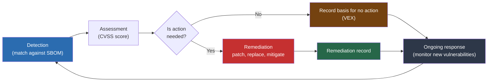

{}
Once identification has shown what you use, the next step is to resolve the issues that come out of
it. There are two kinds of issues: security vulnerabilities and license obligations. This is the
second procedure of the FSEC guide, and it corresponds to vulnerability detection and resolution
(4.3.2) in ISO/IEC 18974 and to handling license use cases (3.3.2) in ISO/IEC 5230.

Documents produced here: vulnerability remediation records (including VEX), and response deadline
criteria by severity.
{}

## From vulnerability detection to remediation

ISO/IEC 18974 requires security assurance activities to be applied to each open source component in
the SBOM (Software Bill of Materials). The whole process from detection to resolution must be set up
as a procedure, and a record of the work done on each vulnerability must be kept. The procedure
follows the flow below. **[ISO requirement]**

- Detection: Check whether each component in the SBOM has known vulnerabilities (CVE, Common
  Vulnerabilities and Exposures).
- Assessment: Assign a risk and impact score to each detected vulnerability, using the Common
  Vulnerability Scoring System (CVSS).
- Remediation decision: Decide on and document the fix or mitigation steps needed for each
  vulnerability. When you judge that no action is needed, record the basis for that judgment as well.
- Remediation: Apply patches, version replacements, mitigating configurations, and so on according
  to the risk score.
- Ongoing response: Monitor vulnerabilities newly disclosed during operation and respond for the
  affected systems.



This procedure is the vulnerability detection and resolution procedure of ISO/IEC 18974 (4.3.2.1),
and the record of carrying it out is the vulnerability and remediation record (4.3.2.2). If you
record a decision that no action is needed in VEX (Vulnerability Exploitability eXchange) format,
you do not have to review the same vulnerability again and again.

### Vulnerability scanning and continuous monitoring example

When you register an SBOM in a vulnerability management tool, the tool reports the affected
components again each time a new vulnerability is disclosed. The example below registers the SBOM
of an operational system in [Dependency-Track](../../tools/7-dependency-track/). The tool is an
example and can be replaced with an equivalent tool.

```bash
# Upload the SBOM to a Dependency-Track project (API example)
curl -X POST "https://dtrack.internal/api/v1/bom" \
  -H "X-Api-Key: $DT_APIKEY" \
  -F "project=$PROJECT_UUID" \
  -F "bom=@foo-1.2.3.sbom.json"
```

After the upload, the tool matches the SBOM against its vulnerability database and builds a list of
vulnerabilities. In a closed network, this database is updated offline. This is not a one-time
check: each time the database is updated, the SBOMs already registered are reassessed and new
vulnerabilities surface automatically. Continuous monitoring of operational systems is covered
further in [Management](../5-manage/).

For a one-time check from the command line, you can use [Grype](https://github.com/anchore/grype)
or [Trivy](https://trivy.dev/).

```bash
# Scan for vulnerabilities using the SBOM as input
grype sbom:foo-1.2.3.sbom.json
```

## Response deadlines

Detection alone is not enough. Unless you set deadlines for remediation by severity, delays are left
unaddressed. Prioritize by looking at severity and exposure together, and state the response
deadline for each level in your policy. The table below is an example of how to set deadlines;
adjust it to your organization's risk tolerance. **[Guide recommendation]**

| Severity (CVSS) | Internet-facing systems | Internal systems |
|------|------|------|
| Critical (9.0 to 10.0) | Immediately to within a few days | Within a few days to 1 week |
| High (7.0 to 8.9) | Within 1 week | Within 2 weeks to 1 month |
| Medium (4.0 to 6.9) | Within the regular review cycle | Within the regular review cycle |

Also define temporary mitigations and an exception approval procedure for cases where remediation
within the deadline is difficult.

{}
In a closed network, patches also have to go through the import procedure, so they cannot be applied
right away. How to obtain patches only from pre-approved mirrors and how to build temporary
mitigations until a patch is applied into the procedure are covered in [Closed Network
Operation](../0-closed-network/#managing-patch-delays).
{}

## Resolving license issues

The other issue to resolve alongside vulnerabilities is licensing. Check the license obligations of
the identified open source, find uses that do not meet those obligations, and resolve them.
ISO/IEC 5230 requires this as the license use case handling procedure (3.3.2.1).
**[ISO requirement]**

In the financial sector, the nature of license issues depends on whether the software is
distributed. This guide looks at the two cases separately.

- Software distributed externally (external services, customer apps): Obligations of
  distribution-triggered licenses such as the GPL family (notices, and in some cases source code
  disclosure) apply. You need a procedure for meeting license obligations.
- Internal operational systems that are not distributed externally: Because there is no
  distribution, source disclosure obligations under the GPL and similar licenses are weak, but you
  still check license compatibility and terms of use.

The FSEC guide also lists, as a check item, having a source code disclosure policy for using
GPL-family software in external distribution. The distinction between distributed software and
internal operational systems is covered further in [Management](../5-manage/).

For license checks, you can use open source tools such as [FOSSology](../../tools/1-fossology/) and
[SCANOSS](../../tools/9-scanoss/). However, check the license of the tool itself as well. The case of
FOSSLight (AGPL-3.0) is covered in [Tool selection in Closed Network
Operation](../0-closed-network/#choosing-tools-for-a-closed-network).

{}
For vulnerabilities and license issues found in outsourced deliverables, first determine who is
responsible. Check whether the contract specifies the obligation to respond to vulnerabilities and
to fulfill license obligations, and decide how to handle cases where the vendor cannot respond.
Requirements at the contract stage are covered in [Usage Approval](../4-approve/).
{}

{}
Organizations setting up a program for the first time start by checking and responding to critical
vulnerabilities in internet-facing systems, and by checking the license obligations of the software
they distribute. Start where the risk is highest and narrow down from there.

Organizations that already run a program put all eight vulnerability handling methods (threat
identification, vulnerability detection, follow-up action, customer notification, analysis of new
vulnerabilities after release, continuous security testing, verification of risk resolution, and
reporting of risk information) in place as procedures, automate vulnerability response, and reuse
decision records through VEX.
{}

## Connection to the FSEC guide and ISO standards

| Issue resolution activity | ISO/IEC 5230 | ISO/IEC 18974 | FSEC guide |
|------|------|------|------|
| Defining vulnerability handling methods | - | 4.1.5.1 Eight handling methods | Identifying and resolving issues |
| Vulnerability detection and resolution procedure | - | 4.3.2.1 Detection and resolution procedure | Identifying and resolving issues |
| Vulnerability and remediation records | - | 4.3.2.2 Vulnerability and remediation records | Identifying and resolving issues |
| Handling license use cases | 3.3.2.1 Handling license use cases | - | Identifying and resolving issues |

Clause-by-clause details of the vulnerability response procedure are covered in [the security
assurance clauses of the ISO/IEC 18974 Conformance Guide](../../iso18974_guide/3-content-review/2-security-assurance/),
and the eight handling methods in [the standard practice implementation clauses](../../iso18974_guide/1-program-foundation/5-standard-practice/).

{}
At the 20th KWG regular meeting (2023-11), KakaoBank shared how it prepared for ISO/IEC 18974 open
source security assurance. It is a security assurance case from the financial sector in which
vulnerability detection and response were systematized.

Source: Heonkwan Ha and Minae Lee (KakaoBank), "KakaoBank Open Source Security Assurance Preparation Case Study" (카카오뱅크 오픈소스 보안 보증 준비 사례 공유), [KWG 20th meeting (2023-11) slides](https://github.com/OpenChain-Project/OpenChain-KWG/releases/download/meeting-slides-legacy/kakaobank-ISO18974-conformance-case-study.pdf).
{}

---

*Last reviewed: 2026-06-10. This page is reviewed when regulations change and once a year on a regular basis.*
