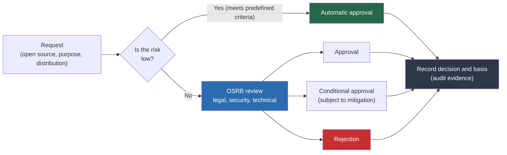

{}
This is the step where you decide whether to actually use open source that has gone through
identification and issue resolution. Approval should not rest on one person's judgment; it should
follow a defined procedure and leave records. This is the third procedure of the FSEC guide, and it
connects to license obligation review (3.1.5) and governance in ISO/IEC 5230.

Documents produced here: approval request, review, and decision records, and open source
requirement clauses for outsourcing contracts.
{}

## Usage approval workflow

Usage approval is the procedure that answers the question "May we use this open source for this
purpose?" The basis for the answer comes from the earlier steps. Identification tells you what it
is, issue identification and resolution tell you its vulnerabilities and license obligations, and
you decide on approval based on those results.

The basic flow is request, review, decision, and record.

- Request: Submit the open source you intend to use, its purpose, and whether it will be distributed.
- Review: Look at license obligations, security vulnerabilities, and technical fit together. The
  reviewer is the Open Source Review Board (OSRB) defined in governance.
- Decision: Choose one of approval, conditional approval (allowed on the condition of mitigating
  measures), or rejection.
- Record: Keep the decision and its basis. This record becomes audit evidence.

Use that involves a network separation exception first requires, separately from this workflow,
approval of the self risk assessment report by the Information Security Committee (or CISO). This is
covered in the section below.

Not every use needs to be reviewed with the same weight. Differentiate the review: approve low-risk
uses automatically using predefined criteria, and send only uses that go into distributed software
or carry significant license obligations to the board. ISO/IEC 5230 requires the license obligation
review procedure (3.1.5.1) as verification material. **[ISO requirement]**

{}
Organizations setting up a program for the first time start by defining the approval request form
and the review criteria. Decide who submits requests, who reviews them, and who gives final approval,
and document it.

Organizations that already run a program reduce the review workload by setting automatic approval
criteria by risk level, and link approval records with the identified asset inventory and audit
evidence.
{}

## Self risk assessment for network separation exceptions

Under the amendment to the Regulation on Supervision of Electronic Financial Transactions
(전자금융감독규정), effective 2025-02-05, work for research and development purposes that does not
process unique identification information or personal credit information can be granted a network
separation exception after a self risk assessment and the application of alternative information
security controls in place of network separation. Approval of the network separation exception
itself is not the responsibility of the Open Source Review Board but of company-wide security
governance, that is, the Information Security Committee (or the Chief Information Security Officer,
CISO).

Open source usage approval interlocks with this procedure. The open source risk information that
goes into the risk assessment report (SBOM, vulnerabilities, licenses) comes from the identification
and issue resolution steps, so the open source management organization provides that information
and supports the review. When reviewing usage approval for open source to be used in a network
separation exception zone, also look at the approved risk assessment report as a supporting
document, and record the decision. What the report contains is covered in [Self risk assessment in
Closed Network
Operation](../0-closed-network/#self-risk-assessment-for-network-separation-exceptions). **[Guide recommendation]**

{}
For open source used inside a closed network, import approval and usage approval are linked. If you
use the verification results from the import step (integrity, malware scan, SBOM, vulnerability
check) in the usage approval review as well, the procedures do not overlap. For the import
procedure, see [Closed Network Operation](../0-closed-network/#import-control).
{}

## Outsourcing contracts and requests for proposal

The financial sector relies heavily on outsourced development and outsourcing arrangements, so usage
approval extends back to the contract stage. To control the open source included in outsourced
deliverables, you need to put open source management requirements into contracts and requests for
proposal in advance.

The requirements to include in contracts are as follows.

- SBOM (Software Bill of Materials) submission: Require the vendor to submit a list of the open source included in the deliverables in a standard format.
- Fulfillment of license obligations: Specify responsibility for license notices and for fulfilling obligations.
- Vulnerability response: Define the obligation and deadline for responding when a vulnerability is found.
- Ownership and attribution of rights: Make clear who owns the deliverables and to whom copyright and intellectual property rights belong.

The last item relates to Article 21 of the Regulation on Supervision of Electronic Financial
Transactions. Before the 2025-02-05 amendment, Article 21 stated that, in building information
processing systems and in electronic financial transaction contracts, the attribution of ownership,
copyright, and intellectual property rights in products must be made clear, and the FSEC guide also
uses this as the basis for its guidance on managing attribution of rights. The amended current
Article 21, instead of listing detailed items, requires establishing and operating internal control
procedures to secure the safety, reliability, and fairness of contracts, and clarifying attribution
of rights remains a valid practice as a core part of that internal control. Stating the attribution
of rights related to open source clearly in outsourcing contracts meets this requirement.
**[FSEC guide]**

{}
Open source used by electronic financial auxiliary service providers (전자금융보조업자) is also kept
within the same approval system. Review and approve the SBOM and vulnerability check results
submitted by the vendor, and state in the contract who bears that responsibility. Also decide how to
compensate when the vendor lacks management capability (scanning directly, requiring alternative
components).
{}

## Connection to the FSEC guide and ISO standards

| Usage approval activity | ISO/IEC 5230 | FSEC guide |
|------|------|------|
| License obligation review | 3.1.5.1 License obligation review procedure | Usage approval |
| Approval decision and record | 3.1.5.1 Review and record procedure (applying 3.3.1.1 approval procedure) | Usage approval |
| Risk assessment for network separation exceptions | - (self-regulated security under the Regulation on Supervision of Electronic Financial Transactions) | Usage approval |
| Attribution of rights in outsourcing contracts | - (internal control under Article 21 of the Regulation on Supervision of Electronic Financial Transactions) | Usage approval (electronic financial auxiliary service providers) |

General practice for the approval process is covered in more detail in [the process section of the
Enterprise Open Source Management Guide](../../opensource_for_enterprise/3-process/). For policy and
procedure forms, use the [policy and procedure templates](../../templates/) supplemented for the
financial context; the supplemented outlines are provided as the artifact [Financial Policy and
Procedure Templates](../artifacts/2-policy-templates/).

{}
At the 13th KWG regular meeting (2022-03), KakaoBank shared its ISO/IEC 5230 certification case and
also introduced its system for reviewing and approving open source use. It is a case of establishing
approval governance in the financial sector.

Source: Heonkwan Ha and Minae Lee (KakaoBank), KakaoBank's part of the 13th meeting joint session "ISO/IEC 5230 Certification Cases of Kakao and KakaoBank" (카카오와 카카오뱅크의 ISO/IEC 5230 인증 사례 공유), [KWG 13th meeting (2022-03) slides](https://github.com/OpenChain-Project/OpenChain-KWG/releases/download/meeting-slides-2022/KakaoBank_ISO_IEC_5230_certification_case.pdf).
{}

---

*Last reviewed: 2026-06-10. This page is reviewed when regulations change and once a year on a regular basis.*
