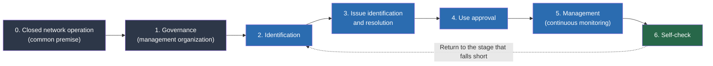

{}

Financial institutions use more and more open source, yet they must manage it under conditions specific
to their sector: closed networks, network separation regulations, supply chain security, and audit
response. This guide connects the management procedures set out in the "Guide to Using and Managing
Open Source Software in the Financial Sector" (금융분야 오픈소스 소프트웨어 활용·관리 안내서;
Financial Supervisory Service (금융감독원) and Financial Security Institute (금융보안원), 2022) with the
verification materials of the international standards ISO/IEC 5230 and 18974 and with the existing KWG
practical guides. It shows practitioners, in an actionable form, what they need to put in place and in
what order.

**Author : OpenChain Korea Work Group / [CC BY 4.0](https://creativecommons.org/licenses/by/4.0/)**

{}

{}
This guide does not replace the Guide to Using and Managing Open Source Software in the Financial
Sector (hereafter the FSEC guide). It is supplementary material that helps put the procedures defined
in the FSEC guide into actual operation. Just as the FSEC guide is non-regulatory, voluntary guidance,
the recommendations in this guide are good practice, not legal obligations.

The scope is the same as that of the FSEC guide. It focuses on the use and management of open source
(license compliance and security management) and does not cover publishing in-house software or
contributing to open source projects. This decision reflects the financial sector's reluctance to
publish software.
{}

## The regulatory environment of the financial sector

Open source management in the financial sector takes place in a regulatory environment that differs
from that of ordinary companies.

The reference for open source management is the FSEC guide. The Financial Supervisory Service and the
Financial Security Institute jointly published it in 2022 (a revised edition from February 2023 also
exists). It sets out minimum security management procedures in four stages: identification, issue
identification and resolution, use approval, and management. It is non-regulatory, voluntary guidance,
and its annexes include a self-check checklist (five categories: identification, issue identification
and resolution, approval, management, and other), major management tools, and operational cases.

The regulatory environment is in transition. Following the "Roadmap for Improving Network Separation in
the Financial Sector" (금융분야 망분리 개선 로드맵) by the Financial Services Commission (금융위원회)
(2024-08-13), amendments to the Regulation on Supervision of Electronic Financial Transactions
(전자금융감독규정) and its Enforcement Rules (시행세칙) took effect on 2025-02-05. With this, regulation
centered on physical network separation began to shift toward voluntary security and a risk-based
approach, and an exception to network separation was opened for research and development work. The
requirements for applying the exception, further relaxations, and how to respond are covered in
[Closed Network Operation and the Network Separation
Transition](./0-closed-network/).

Supply chain security is becoming more important. The Financial Security Institute has built the
Financial Sector Software Supply Chain Security Platform (금융권 소프트웨어 공급망 보안 플랫폼), which
went through a pilot operation at the end of 2025 and enters full operation in 2026. It provides
integrated vulnerability management for the financial sector, an SBOM (Software Bill of Materials)
management system, and more efficient bug bounty operation. The government also announced the
"Software Supply Chain Security Guidelines 1.0" (SW 공급망 보안 가이드라인 1.0; Ministry of Science and
ICT (과학기술정보통신부), National Intelligence Service (국가정보원), and Presidential Committee on the
Digital Platform Government (디지털플랫폼정부위원회), 2024-05-13), and is pursuing step-by-step
institutionalization with the goal of mandatory SBOM submission in the public sector in 2027. Abroad,
the United States and Europe are moving toward mandatory SBOM submission, and the European Union's
Digital Operational Resilience Act (DORA) entered into force in 2023 and applies from 2025-01-17. It
requires ICT third-party risk management and management of open source vulnerabilities and patches. It
directly affects financial institutions that operate in or are entering Europe.

## How to read this guide

How you read this guide depends on the maturity of your open source management system. Each section
distinguishes what a new organization should do first from how an operating organization can advance,
so assess where your organization stands and then choose the relevant parts.

An organization setting up a system for the first time sorts out its environment with [Closed Network
Operation](./0-closed-network/), then follows the sections in order from
[Governance](./1-governance/) to [Management](./5-manage/), creating the documents and procedures each
stage describes one at a time.

An organization that already operates a system evaluates its current state with
[Self-Check](./6-self-check/) and goes back to the stages where it falls short to improve them.

### Maturity ladder

The Open Source Readiness maturity model of FINOS (Fintech Open Source Foundation) divides an
organization's stages into
Usage, Compliance, Contribution, Hosting, and Strategic Leverage. Because this guide focuses on use and
management, it corresponds to the first two stages: Usage, where the organization uses open source, and
Compliance, where it has compliance in place. Stages from Contribution onward are not covered.

| Stage | State | What to do in this guide | FINOS equivalent |
|------|------|------|------|
| New | Uses open source but has no management system | Sort out the closed network environment, establish governance, start identification | Usage |
| Operating | Identification, approval, and management procedures are running | Formalize vulnerability response procedures, systematize use approval, continuous monitoring | Compliance |
| Advanced | Procedures are automated and audits can be answered | Integrate with the supply chain platform, audit evidence system, periodic reassessment | Compliance (advanced) |

## Mapping of the FSEC guide, ISO standards, and KWG guides

This table links each procedure in the FSEC guide to the corresponding ISO/IEC 5230 and 18974
verification materials, to the pages of existing KWG guides where specific methods can be found, and to
the section of this guide that covers it. It is the starting material for self-certification
preparation.

| FSEC procedure | Section of this guide | ISO/IEC 5230 verification material | ISO/IEC 18974 verification material | Existing KWG guide |
|------|------|------|------|------|
| (Governance) | [1. Governance](./1-governance/) | 3.1.1.1 Policy, 3.1.2.1 Roles and responsibilities, 3.2.2.1 Role holders | 4.1.2.3 Participants and role mapping | [Organization](../opensource_for_enterprise/1-teams/) |
| Identification | [2. Identification](./2-identify/) | 3.1.4.1 Scope, 3.3.1.1 SBOM management, 3.3.1.2 Component records | - | [SBOM and tools](../opensource_for_enterprise/4-tool/), [§3.3.1](../iso5230_guide/3-content-review/1-sbom/) |
| Issue identification and resolution | [3. Issue Identification and Resolution](./3-issue-resolve/) | 3.3.2.1 Handling license use cases | 4.3.2.1 Vulnerability detection and resolution procedure, 4.3.2.2 Records of vulnerabilities and actions | [ISO/IEC 18974 guide](../iso18974_guide/) |
| Use approval | [4. Use Approval](./4-approve/) | 3.1.5.1 License obligation review procedure | - | [Process](../opensource_for_enterprise/3-process/) |
| Management | [5. Management](./5-manage/) | 3.4.1.1 Creating compliance artifacts, 3.4.1.2 Archiving compliance artifacts | 4.1.2.5 Evidence of periodic review and changes | [ISO/IEC 18974 guide](../iso18974_guide/) |
| (Check across all stages) | [6. Self-Check](./6-self-check/) | 3.6.1.1 Confirmation of meeting requirements | - | [Declaring conformance](../opensource_for_enterprise/6-conforming/) |

ISO/IEC 5230 consists of 25 verification materials across 13 clauses, and ISO/IEC 18974 consists of 25
verification materials from a security assurance perspective (9 of which are specific to 18974). For
clause-by-clause details of the verification materials, see the [ISO/IEC 5230 Conformance
Guide](../iso5230_guide/) and the [ISO/IEC 18974 Conformance Guide](../iso18974_guide/).

## Structure of this guide

Sections 2 to 5 correspond to the four stages of the FSEC guide (identification, issue identification
and resolution, use approval, and management). Before and after them are closed network operation (0)
and governance (1), which are common premises in the financial sector, and self-check (6), which reviews
all stages.

| Section | What it covers |
|------|------|
| [0. Closed Network Operation](./0-closed-network/) | Import control, internal mirrors, offline vulnerability management, self risk assessment for network separation exceptions |
| [1. Governance](./1-governance/) | Management organization and roles, Open Source Review Board (OSRB), approval governance |
| [2. Identification](./2-identify/) | Identifying incoming open source and legacy, SBOM, identifying third-party and outsourced components, integration with the supply chain platform |
| [3. Issue Identification and Resolution](./3-issue-resolve/) | Vulnerability assessment and response, resolving license issues, managing patch delays |
| [4. Use Approval](./4-approve/) | Approval workflow, risk assessment for network separation exceptions, contract (request for proposal) management |
| [5. Management](./5-manage/) | Continuous monitoring of in-house production systems, periodic reassessment, audit evidence |
| [6. Self-Check](./6-self-check/) | Self-check workbook (check items, verification materials, and tool links) |

## Starting with the self-check

If you are not sure what stage your organization is at, start with [Self-Check](./6-self-check/). Its
check items were newly written in the wording of this guide, drawing on the intent of the five
categories of the FSEC guide, and are linked to ISO verification materials and recommended tools. You
can use them to find what is missing and move to the section that covers it.

{}
Each page distinguishes sources with the following labels.

- **[ISO requirement]**: An item that the ISO/IEC 5230 or 18974 standard explicitly requires as a verification material.
- **[FSEC guide]**: An item that the FSEC guide sets out as a procedure. The FSEC guide is non-regulatory, voluntary guidance.
- **[Guide recommendation]**: An item not found in the standards or the FSEC guide but recommended on the basis of practice and the financial regulatory environment.
  Adoption is at the organization's discretion.
{}

{}
This guide builds on the existing guides. General practice for organization, policy, process, tools, and
training is covered in the [Enterprise Open Source Management Guide](../opensource_for_enterprise/), and
clause-by-clause details of the standards' verification materials are covered in the [ISO/IEC 5230
Conformance Guide](../iso5230_guide/) and the [ISO/IEC 18974 Conformance Guide](../iso18974_guide/).
This guide adds the financial sector context of closed networks, network separation, supply chain, and
audits on top of them.
{}

## Sources

- Guide to Using and Managing Open Source Software in the Financial Sector (Financial Supervisory Service and Financial Security Institute, 2022). [Posted by the Financial Security Institute](https://www.fsec.or.kr/bbs/detail?menuNo=222&bbsNo=11166)
- Roadmap for Improving Network Separation in the Financial Sector (Financial Services Commission, 2024-08-13). [Financial Services Commission press release](https://www.fsc.go.kr/no010101/82885)
- Amendments to the Regulation on Supervision of Electronic Financial Transactions and its Enforcement Rules (Financial Services Commission, effective 2025-02-05).
- Financial Sector Software Supply Chain Security Platform (Financial Security Institute, full operation in 2026). [DailySecu report](https://www.dailysecu.com/news/articleView.html?idxno=204828)
- Software Supply Chain Security Guidelines 1.0 (Ministry of Science and ICT, National Intelligence Service, and Presidential Committee on the Digital Platform Government, 2024-05-13). [Korea Policy Briefing](https://www.korea.kr/news/policyNewsView.do?newsId=148929111)
- Plan for mandatory SBOM submission in the public sector (target and plan for 2027). [Datanet report](https://www.datanet.co.kr/news/articleView.html?idxno=208920)
- EU DORA (Digital Operational Resilience Act, applies from 2025-01-17). [EIOPA overview](https://www.eiopa.europa.eu/digital-operational-resilience-act-dora_en)
- [FINOS Open Source Readiness](https://osr.finos.org/docs/bok/introduction)
- [ISO/IEC 5230](https://www.iso.org/standard/81039.html), [ISO/IEC 18974](https://www.iso.org/standard/86450.html)

---

*Last reviewed: 2026-06-10. This guide is reviewed when regulations change and once a year on a regular basis.*
