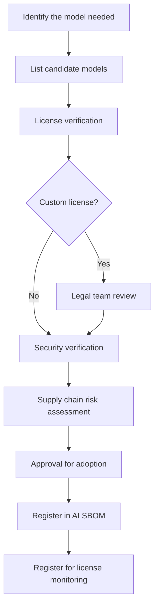

## 1. Overview

ISO/IEC 42001 §8.8 requires appropriate evaluation and verification when using AI systems (models, APIs, services)
procured externally. From an open source perspective, the key is the procedure for verifying license, security, and supply chain risks
when procuring **external open source AI models**.

---

## 2. Three Types of External AI Procurement

| Type | Examples | Open source relevance |
|------|------|--------------|
| **Direct use of open source AI models** | Downloading Llama, Mistral, or Falcon model weights | High: the license applies directly |
| **AI services based on open source** | Hugging Face Inference API, Ollama | Medium: the license of the underlying model must be checked |
| **Commercial AI APIs** | OpenAI API, Google Vertex AI | Low: terms of service apply (OSS licenses do not apply directly) |

Types 1 and 2 are areas where open source licenses apply directly and are the main subjects of §3 to §4.
Type 3 (commercial AI APIs) is also required in the same way by ISO/IEC 42001 §8.8, so it is covered separately in §5.

---

## 3. Verification Checklist Before Procuring Open Source AI Models

Verify the following items before adopting an external open source AI model.

### 3.1 License Verification

```markdown
## Open Source AI Model License Verification Checklist

### Basic license information
- [ ] License type confirmed: ___________________
      (Apache 2.0 / MIT / Llama Community / Gemma ToU / other)
- [ ] Source URL of the license text: ___________________
- [ ] License version confirmed (may differ from earlier versions of the same model)

### Commercial use conditions
- [ ] Whether commercial use is permitted: ✅ Permitted / ⚠️ Conditional / ❌ Not permitted
- [ ] Conditions limiting the number of users (MAU): ___________________
      (for example, Llama 3: permission from Meta required above 700 million MAU)
- [ ] Revenue-based restrictions: ___________________

### Derivative (fine-tuning) conditions
- [ ] Whether fine-tuning is permitted: ✅ Permitted / ⚠️ Conditional / ❌ Not permitted
- [ ] Whether there is an obligation to disclose fine-tuned models: ___________________
- [ ] License requirements for fine-tuned models: ___________________

### Redistribution conditions
- [ ] Whether redistribution of model weights is permitted: ✅ Permitted / ⚠️ Conditional / ❌ Not permitted
- [ ] Obligation to include license documents when redistributing: ___________________

### Attribution obligations
- [ ] Whether attribution is required: ✅ Required / ❌ Not required
- [ ] Attribution method and location: ___________________
      (service UI, documentation, API responses, and so on)

### Whether legal review is required
- [ ] Legal team review completed if not a standard SPDX license: ✅ / Not applicable
- [ ] Date of legal team review: ___________________
- [ ] Review opinion: ___________________
```

### 3.2 Security Verification

```markdown
### Security verification items
- [ ] Download from an official distribution channel confirmed
      (official GitHub, official Hugging Face account)
- [ ] Exact match with the official namespace confirmed (typo-squatting defense; see §6.1 for detailed cases and defensive controls)
- [ ] File hash (SHA256) verified and recorded in the AI SBOM
- [ ] Model weight format confirmed
      (Safetensors preferred; `.pt` and `.bin` pickle formats are verified in an isolated environment before use in production)
- [ ] Known vulnerabilities (CVEs) looked up
      (NVD, OSV.dev search results: ___________________)
- [ ] Model weights reviewed for inserted malicious code or backdoors
      (do not use models from untrusted sources; check for backdoor triggers with evaluation datasets)
- [ ] Registered with a channel for monitoring license changes
      (GitHub Watch, official newsletter, and so on)
```

### 3.3 Supply Chain Risk Assessment

```markdown
### Supply chain risk assessment items
- [ ] Trustworthiness of the model supplier confirmed
      (individual / research institution / company; reputation in the open source community)
- [ ] Maintenance activity of the model confirmed
      (date of last update, status of issue responses)
- [ ] License change history confirmed
      (whether license terms have changed in the past)
- [ ] Alternative models identified
      (alternatives in case of a license change or service discontinuation)
```

---

## 4. Summary of License Risks of Major Open Source AI Models

| Model family | License | Main risks |
|---------|---------|-----------|
| **Llama 3.x** | Meta Llama Community License | Meta approval required above 700 million MAU, differences in terms between license versions |
| **Llama 2** | Meta Llama 2 Community License | Restrictions on use by competitors (from Meta's standpoint), restrictions on using the "Llama 2" name for derivative models |
| **Gemma 2** | Google Gemma ToU | License terminates immediately upon violation of Google's usage policy |
| **Falcon-7B / 40B** | Apache-2.0 (since 2023-09) | Low risk: commercial use is free |
| **Falcon-180B** | TII Falcon LLM License v1.0 | Conditional commercial use, such as revenue thresholds; the original terms must be checked directly |
| **Mistral 7B** | Apache 2.0 | Low risk |
| **Phi-3** | MIT | Low risk |
| **GPT-2, BERT** | MIT / Apache 2.0 | Low risk |

{}
For models under custom licenses such as Llama and Gemma, **read the license text directly**
and use the model only after a legal team review. Custom licenses are not SPDX standard licenses,
so they cannot be reviewed automatically by common license classification tools.
{}

---

## 5. §8.8 Evaluation Checklist for Commercial AI APIs

Open source licenses do not apply directly to commercial AI APIs such as OpenAI, Anthropic, Google Vertex AI, AWS Bedrock, and Azure OpenAI,
but ISO/IEC 42001 §8.8 equally requires evaluation of externally supplied
AI systems. Review the following three areas before adoption.

### 5.1 Verifying Data Processing and Use for Training

```markdown
### Data processing verification items
- [ ] Whether input data is used for training (opt-in / opt-out policy)
      (confirm whether Enterprise/API plans are opt-out by default)
- [ ] Retention period of output data (whether a zero-retention option is available)
- [ ] Location (country) where API call logs are stored: review cross-border transfer under the Personal Information Protection Act (개인정보보호법)
- [ ] Whether the data processing region can be selected (EU or KR regions, and so on)
- [ ] Whether a BAA (Business Associate Agreement) can be signed (healthcare sector)
- [ ] Whether a policy blocking input of sensitive information and trade secrets has been established
```

### 5.2 Comparison of IP Indemnification

To address the risk of copyright infringement by generative AI output, major providers operate IP indemnification policies.
Coverage and conditions differ by plan, so check the **original terms** and the **latest policy pages** directly.

| Provider | Name of indemnification policy | Conditions (summary) |
|--------|--------------|---------------|
| **OpenAI** | Copyright Shield | ChatGPT Enterprise, Team, and API users (ChatGPT Plus and free plans explicitly excluded) |
| **Anthropic** | IP Indemnification | When subscribed under the Commercial Service Agreement |
| **Google Cloud** | Generative AI Indemnification | Models named in the Vertex AI terms, when the terms are complied with |
| **AWS** | IP Indemnification | Bedrock Titan + third-party models named in the terms (some, such as Claude and Llama; check the original terms), Amazon Q |
| **Microsoft (Azure OpenAI)** | Customer Copyright Commitment | Azure OpenAI Service |
| **Microsoft (M365 Copilot)** | Copilot Copyright Commitment | M365 Copilot, GitHub Copilot Business/Enterprise |

Common indemnification requirements: content filters enabled, post-review of output, no intentional attempts at infringement,
and lawful rights to input data (assurance that the copyright and license of materials the user enters in the prompt are lawful).
The scope of damages that can be claimed under indemnification (legal advisory costs, settlements, and so on) differs by provider, so consult the legal team in advance.
Actual terms change frequently, so check the **original terms** directly before adoption.

### 5.3 Monitoring Changes to Terms of Service and Availability

```markdown
### Terms and availability monitoring items
- [ ] Registered with a channel for notifications of terms changes (email notifications, RSS of the change log page)
- [ ] Price change policy confirmed (contractual advance notice period)
- [ ] SLA availability guarantee level (for example, 99.9%)
- [ ] End-of-service (EOL) policy: secure a migration period
- [ ] Alternative providers identified (preventing vendor lock-in; maintain a mapping table of equivalent models)
- [ ] Review of clauses limiting liability for output (hallucination and bias disclaimer clauses)
```

{}
To prepare for availability, terms change, and pricing risks of commercial APIs, it is recommended to **secure a self-hosted open source model option
as a backup**. Recording the model mapping for both options together in the AI SBOM
enables a quick switchover.
{}

---

## 6. Defending Against Model Supply Chain Attacks

Since 2024, open source model weight files and model hubs (Hugging Face, PyTorch Hub, and others) have been identified as a **new
attack surface**. Before adoption, be aware of the following attack types and apply defensive controls.

### 6.1 Known Attack Types

| Attack | Description | Defense |
|------|------|------|
| **Pickle RCE** | Arbitrary code inserted into models serialized with Python pickle, such as PyTorch `.pt` and `.bin`. Executed when the model is loaded | Prefer the Safetensors format, load untrusted models in an isolated container |
| **Typo-squatting** | Publishing misspelled variants of model or package names on Hugging Face or PyPI (for example, `meta-Ilama` vs `meta-llama`) | Explicit verification of the official namespace, pinning PURLs, hash verification at download |
| **Model Poisoning** | Backdoors inserted into training data or weights, producing malicious output when a specific trigger input is given | Trusted providers, comparison against benchmark datasets, checking for trigger patterns |
| **License-flip** | Changing the model license after the fact and attempting to apply it retroactively to existing users | Keep the license text and weight hash at the time of download together |
| **Dependency Confusion** | Publishing a public model with the same name as a private model to induce incorrect downloads | Explicitly specify the namespace, set private registry priority |

### 6.2 Recommended Defensive Controls

```markdown
### Model supply chain defensive controls checklist
- [ ] Prefer the Safetensors format for model weights (avoid pickle)
- [ ] Pin model file hashes (SHA-256) + record them in the AI SBOM
- [ ] Adopt OpenSSF Model Signing and Sigstore signature verification (§6.3)
- [ ] Assess the SLSA for AI build level (§6.4)
- [ ] Verify models first in an isolated environment (sandbox) before moving them to production
- [ ] Mandatory prior review by the security team when adopting new models
- [ ] Automate typo-squatting checks of model hub accounts (CI stage)
- [ ] Keep the model license text, weight hash, and download date together
```

{}
In February 2024, JFrog Security researchers identified **about 100 malicious models** on the Hugging Face Hub.
Many of them were designed to abuse pickle serialization to execute RCE payloads such as reverse shells when the model is loaded
(some were for system reconnaissance). Hugging Face had operated PickleScan and the Safetensors
format before the incident, but the incident led to strengthened security. **The official recommendation is to use the Safetensors format
from trusted sources**.
{}

### 6.3 Adopting OpenSSF Model Signing

[OpenSSF Model Signing](https://github.com/sigstore/model-transparency) is an ML model signing standard
that supports three methods: Sigstore (keyless OIDC signing), X.509 certificates, and public keys.
As of 2026, the official package name is `model-signing` (v1.1+).

**(1) Installation**

```bash
# Basic installation (uses Sigstore)
pip install model-signing

# Including X.509 (PKCS #11 HSM) support
pip install model-signing[pkcs11]
```

**(2) Signing a model (Sigstore keyless method, recommended)**

```bash
# Compute a digest over the entire model directory and sign it with Sigstore
# → Sigstore Fulcio issues a short-lived certificate for the OIDC identity and records it in the Rekor transparency log
# → Creates the model.sig file
model_signing sign sigstore /path/to/llama-3.1-8b
```

**(3) Verifying a model (confirming the signer's identity)**

```bash
# Example using Google OIDC
model_signing verify sigstore /path/to/llama-3.1-8b \
  --signature model.sig \
  --identity "release-bot@example.com" \
  --identity_provider "https://accounts.google.com"

# Example using GitHub Actions OIDC (most common in CI environments)
model_signing verify sigstore /path/to/llama-3.1-8b \
  --signature model.sig \
  --identity "https://github.com/myorg/myrepo/.github/workflows/release.yml@refs/heads/main" \
  --identity_provider "https://token.actions.githubusercontent.com"
```

> Recheck the exact CLI syntax in the official [`sigstore/model-transparency`](https://github.com/sigstore/model-transparency) README at the time of adoption (subcommand and option names may change between versions).

**(4) Using your own keys (offline environments)**

```bash
# Signing (your own key pair, such as RSA/EC)
model_signing sign key /path/to/model --private_key signing.key

# Verification
model_signing verify key /path/to/model --signature model.sig --public_key signing.pub
```

**(5) Linking with the AI SBOM**

Record the signature verification results (signer identity, issue date, Rekor log index) in the AI SBOM
`hashes` and `attestation` fields to secure audit traceability. In CycloneDX 1.6, they can be attached directly
to the `signature` field of the component.

### 6.4 SLSA for AI Build Levels

The build track of [SLSA (Supply-chain Levels for Software Artifacts)](https://slsa.dev/spec/v1.0/)
applies equally to ML model build pipelines. **SLSA for AI** is a use case that maps it
to the model training, fine-tuning, and conversion processes.

| Level | Requirements (applied to ML models) | Use |
|------|----------------------|------|
| **L0** | (A convenience label for the state where SLSA is not applied; not a level defined by the standard) No provenance | Allowed only for local experiments and research |
| **L1** | The build platform automatically generates provenance (training data, code, hyperparameters, environment) | Internal models in general |
| **L2** | Provenance carries a tamper-resistant signature (in-toto attestation + Sigstore), using a hosted builder | Externally distributed models and models provided to customers |
| **L3** | Prevention of user-defined code injection (covert or explicit) during the build: blocking injection of training code and hyperparameters outside the build definition, hardened build environment | High-risk and regulated industries |

The official stable version of SLSA is v1.0 (GA in 2023-04), and a v1.1 draft is in progress. At the time of adoption,
check the latest stable version in the [official SLSA specification](https://slsa.dev/spec/v1.0/).

**Key items to include in ML model provenance**

- Training data hash (dataset version, license)
- Training code git commit, CI/CD builder ID
- Hyperparameters, training environment (GPU type, library versions)
- Base model ID and hash (for fine-tuning)
- Build start and end times, builder identity

**Recommended order of application**

1. **Adopt L1 first**: Automatically generate provenance in the training pipeline (for example, a GitHub Actions builder automatically outputs an in-toto attestation)
2. **L2 stage**: Add a Sigstore signature to the provenance (using the tools in §6.3)
3. **L3 stage**: Adopt a hardened build environment (for example, isolated workflows on GitHub Actions hosted runners, isolated GCP/AWS builders)
4. Record the SLSA level in the AI SBOM (`properties.slsaLevel`)

{}
OpenSSF Model Signing (signing), Sigstore (transparency log), and SLSA for AI (provenance) are
three complementary standards. Model distributors generate SLSA L2 or higher provenance as an in-toto attestation
and sign and register it with Sigstore using the model-signing CLI, and verifiers can then check for tampering
through the Rekor log. This combination is the de facto industry standard for ML supply chain security in 2026.
{}

---

## 7. External AI Model Procurement Process



**Checkpoints**:
- [ ] Was the license verification procedure performed before adopting the external open source AI model?
- [ ] For models under custom licenses, has the legal team review been completed?
- [ ] Are the adopted external models registered in the AI SBOM?
- [ ] Is there a channel for monitoring license changes of external models?
- [ ] Have alternative models been identified for use in case license terms are violated?
- [ ] When adopting a commercial AI API, was the §5 evaluation (data processing, IP indemnification, terms monitoring) performed?
- [ ] Have the hash, format (Safetensors preferred), and namespace of the model weight files been verified?

---

## 8. References

- [Operation section home](../)
- [Open Source Management in AI Systems](../1-oss-in-ai/)
- [AI SBOM Guide](../2-ai-sbom/)
- [ISO/IEC 18974: §4.3.2 Security Assurance](../../../iso18974_guide/3-content-review/2-security-assurance/)
- [Enterprise Open Source Management Guide: AI Compliance](../../../opensource_for_enterprise/7-ai-compliance/)
- [AI Work Group](../../../../resource/AI_work_group/)
