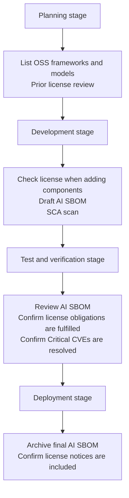

## 1. Overview

ISO/IEC 42001 §8 covers the **actual operation** stage of the AI management system.
From an open source perspective, §8 is the section with the most points of intersection.

| Subclause | Description | Open source intersection |
|---------|------|-------------|
| §8.1 | Operational planning and control | Operating the open source review process |
| §8.2 to 8.3 | AI risk assessment and treatment (during operation) | Responding to OSS vulnerability risks |
| §8.4 | AI system impact assessment (during operation) | System impact of OSS vulnerabilities |
| **§8.5** | AI system life cycle | ★ OSS framework and model licenses |
| **§8.6** | Data for AI systems | ★ Open dataset licenses |
| §8.7 | Feedback interface | - |
| **§8.8** | Procurement of external AI systems | ★ Supply chain verification of external OSS models |

---

## 2. Detailed Pages

The open source intersection items of this section are covered in detail on the following pages:

| Page | Target clauses | Key content |
|--------|---------|---------|
| [Open Source Management in AI Systems](./1-oss-in-ai/) | §8.5, §8.6 | License compliance for AI frameworks, models, and datasets |
| [AI SBOM](./2-ai-sbom/) | §7.5, §8.5 | Building AI SBOMs, generation tools, using SPDX 3.0 |
| [AI Supply Chain Verification](./3-supply-chain/) | §8.8 | Verification checklist for procuring external open source AI models |

---

## 3. §8.1 Operational Planning: Integrating the Open Source Review Process

Integrate open source compliance review steps into the AI system development process.

**Checkpoints**:
- [ ] Does the AI system development process include open source compliance review steps?
- [ ] Is there a gate that prevents an AI system from being deployed without open source review?

---

## 4. References

- [ISO/IEC 42001 Guide home](../)
- [Enterprise Open Source Management Guide: 3. Process](../../opensource_for_enterprise/3-process/)
- [Enterprise Open Source Management Guide: AI Compliance](../../opensource_for_enterprise/7-ai-compliance/)
