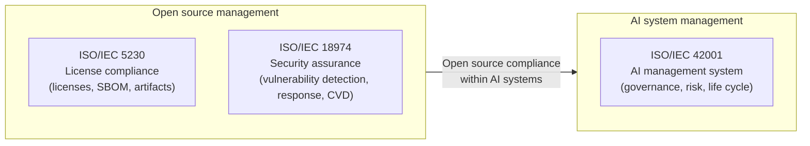

## 1. Relationship Among the Three Standards

A company that develops AI systems using open source stands at the point where three standards intersect.



ISO 5230 and 18974 are standards for managing **open source itself**,
while ISO 42001 is a standard for managing **AI systems**. The two areas are independent,
but they intersect when AI systems use open source.

{}
While ISO/IEC 42001 sets out requirements as principles,
**ISO/IEC 42003** is guidance (a newly approved work item) that explains specific ways to implement 42001.
The OpenChain AI Work Group is working to have the **AI SBOM** reflected in the transparency and explainability clause of ISO 42003
(Appendix C.2.11, Transparency and Explainability).
For the latest developments on mandatory AI SBOMs, see [AI Work Group activities](../../../resource/AI_work_group/).
{}

---

## 2. Comparison of Basic Information

| Item | ISO/IEC 5230 | ISO/IEC 18974 | ISO/IEC 42001 | ISO/IEC 42003 |
|-----------|-------------|--------------|--------------|--------------|
| **Status** | Published (2020) | Published (2023) | Published (2023) | In development |
| **Developed by** | OpenChain Project → ISO | OpenChain Project → ISO | ISO JTC 1/SC 42 | ISO JTC 1/SC 42 |
| **Maintained by** | Linux Foundation OpenChain | Linux Foundation OpenChain | ISO | ISO |
| **Standard family** | OpenChain-specific standard | OpenChain-specific standard | ISO management system standard | ISO 42001 implementation guidance |
| **Scope** | Open source in the software supply chain | Open source security vulnerabilities | AI systems as a whole | How to implement ISO 42001 |
| **Main subject of management** | Fulfilling license obligations | CVE detection and response | AI governance and life cycle | Including AI SBOM and transparency |

---

## 3. SC 42 Family Mapping

ISO/IEC 42001 is not a standalone standard but the core of the family of AI standards developed by the
**ISO/IEC JTC 1/SC 42 (Artificial intelligence)** committee. Referring to the following standards together during certification audits
and practical application helps meet the requirements more fully.

| Standard number | Title | Published | Role (relationship with 42001) |
|----------|------|------|---------------------|
| **ISO/IEC 22989:2022** | AI concepts and terminology | 2022 | Terminology baseline for 42001 |
| **ISO/IEC 23053:2022** | Framework for AI systems using ML | 2022 | Reference model for ML system structure |
| **ISO/IEC 23894:2023** | Guidance on risk management | 2023 | Specific guidance for 42001 §6.1 risk management |
| **ISO/IEC 38507:2022** | Governance implications of AI | 2022 | AI governance guidance for boards and executives |
| **ISO/IEC 5338:2023** | AI System life cycle processes | 2023 | Specific processes for the 42001 §8.5 AI life cycle |
| **ISO/IEC 5339:2024** | Guidance for AI applications | 2024 | Guidance for AI application developers |
| **ISO/IEC TR 5469:2024** | Functional safety and AI systems | 2024 | Safety-critical AI systems |
| **ISO/IEC 42001:2023** | AI Management System (AIMS) | 2023 | **Certifiable core standard** |
| **ISO/IEC 42003** | AIMS implementation guidance | In development | 42001 implementation guidance (efforts to include AI SBOM) |
| **ISO/IEC 42005:2025** | AI System Impact Assessment | 2025 | Specific method for the 42001 §6.1.4 impact assessment |
| **ISO/IEC 42006** | Bodies providing audit and certification of AIMS | 2025 | Requirements for 42001 certification bodies |

### 3.1 Combinations Often Referred to Together in Certification Audits

| 42001 clause | SC 42 standard referred to together | Use |
|----------|------------------------|------|
| §5.2 AI policy | ISO/IEC 38507 (governance) | Stating board responsibilities explicitly |
| §6.1.2 Risk assessment | ISO/IEC 23894 | Standardizing risk identification, analysis, and evaluation procedures |
| §6.1.4 Impact assessment | **ISO/IEC 42005** | Eight assessment areas, identification of interested parties |
| §7.3 Awareness and competence | ISO/IEC 22989 | Consistent training materials through common terminology |
| §8.5 Life cycle | **ISO/IEC 5338** | Consistency of processes at each stage |
| §9.1 Performance evaluation | ISO/IEC TR 24368 | Measuring ethical impact |

### 3.2 Combining Open Source Compliance with the SC 42 Family

| Area | Open source standard | SC 42 standard | Integrated use |
|------|--------------|-----------|----------|
| **AI SBOM** | ISO/IEC 5230 §3.3.1 | ISO/IEC 42003 (in development) | SPDX 3.0 AI Profile + CycloneDX 1.6 ML-BOM |
| **Vulnerability management** | ISO/IEC 18974 §4.3.2 | ISO/IEC 23894 | Integrating OSS CVEs into the AI risk assessment |
| **Impact assessment** | - | **ISO/IEC 42005:2025** | Including the impact of training data sources and licenses in the assessment areas |
| **AI life cycle** | ISO/IEC 5230 §3.3 | **ISO/IEC 5338:2023** | Mandatory review of OSS components at each stage |

{}
Organizations preparing for ISO 42001 certification are recommended to review the SC 42 family standards in the following order:
`(1) 22989 (terminology) → (2) 23894 (risk) → (3) 42005 (impact assessment) → (4) 5338 (life cycle) → (5) 42003 (implementation guidance, once published)`.
Using these five standards together with 42001 makes it possible to meet the level of specificity that certification auditors require without difficulty.
{}

---

## 4. Comparison of Requirement Formats

The three standards express requirements in fundamentally different ways.

### ISO/IEC 5230 and 18974 Approach: Numbered Verification Materials

Each clause specifies by number the <strong>verification materials (Verification Material)</strong> the company must provide.

```
§3.1.1 Policy
  Verification materials:
  - 3.1.1.1 A documented open source policy
  - 3.1.1.2 A documented procedure to communicate the policy
```

If the verification material exists, the requirement is ✅ met; if not, it is ❌ not met, so the judgment is clear.

### ISO/IEC 42001 Approach: Management System "Shall" Requirements

Each clause presents **requirements as principles** in the form "the organization shall ...",
and the organization decides, according to its context, which documents or records will satisfy them.

```
§5.2 AI policy
  "Top management shall establish an AI policy.
   The AI policy shall be appropriate to the purpose of the organization..."
```

For this reason, ISO 42001 is difficult to self-certify with a simple checklist as with ISO 5230/18974,
and an internal gap analysis or an audit by an external certification body is needed.

---

## 5. Comparison of Self-Certification Methods

| Item | ISO/IEC 5230 | ISO/IEC 18974 | ISO/IEC 42001 |
|-----------|-------------|--------------|--------------|
| **Official self-certification tool** | OpenChain online checklist | OpenChain online checklist | None |
| **Self-certification cost** | Free | Free | Free (internal effort required) |
| **Basis for self-certification** | Declaration of checklist completion | Declaration of checklist completion | Self-declaration after an internal gap analysis |
| **Independent assessment** | OpenChain partners | OpenChain partners | Consulting firms |
| **Third-party certification** | OpenChain-accredited bodies | OpenChain-accredited bodies | ISO certification bodies such as BSI and TÜV SÜD |
| **Certification renewal** | 18 months | 18 months | According to the contract with the ISO certification body |

---

## 6. Comparison of Open Source Relevance

| ISO 42001 clause | Open source intersection | Corresponding ISO 5230 | Corresponding ISO 18974 |
|----------------|-------------------|--------------|---------------|
| §5.2 AI policy | Including OSS use principles in the AI policy | §3.1.1 Policy | §4.1.1 Policy |
| §6.1.2 AI risk assessment | OSS license and vulnerability risks | - | §4.3.2 Security assurance |
| §6.1.4 AI impact assessment | Impact analysis of OSS components | - | §4.1.5 Standard practice |
| §7.2 Competence | OSS compliance competence | §3.1.2 Competence | §4.1.2 Competence |
| §7.5 Documentation | AI SBOM | §3.3.1 SBOM | §4.3.1 SBOM |
| §8.5 AI life cycle | OSS framework licenses | §3.3 Content review | §4.3 Content review |
| §8.6 AI data | Open dataset licenses | §3.3.2 Licenses | - |
| §8.8 External AI procurement | Supply chain verification of OSS models | §3.3 Content review | §4.3.2 Security assurance |
| §9.1 Performance evaluation | OSS compliance metrics | §3.6 Conformance | §4.4 Conformance |

---

## 7. Which Standard Should You Start With?

{}

**If you have no open source compliance framework**

Start with **ISO/IEC 5230**.
Build the foundation of license management, SBOM, policy, and training.

---

**If you have an ISO 5230 framework and also develop AI**

Review **ISO/IEC 18974 + ISO/IEC 42001** in parallel.

- ISO 18974: Strengthen management of vulnerabilities in open source used in AI systems
- ISO 42001: Establish governance for AI systems as a whole (including the requirements that intersect with open source)

The two standards complement each other, so pursuing them at the same time reduces duplicated work.

---

**If you are a company that develops and provides AI systems as services**

Check the open source intersection requirements of **ISO/IEC 42001** first.
The [Operation section](../4-operation/) of this guide describes the items you need to check right away in AI systems.

---

**If you want to follow the trend toward mandatory AI SBOMs**

Watch developments in **ISO/IEC 42003**.
The OpenChain AI Work Group is working to have the AI SBOM compliance guide reflected in ISO 42003.
The EU Cyber Resilience Act (CRA) is also being discussed in a direction that requires AI SBOMs as a means of transparency for AI systems.

{}

---

## 8. Common Foundation When Operating the Three Standards Together

Common elements that can serve as a single foundation when complying with the three standards at the same time:

| Common foundation element | ISO 5230 | ISO 18974 | ISO 42001 |
|----------------|:--------:|:---------:|:---------:|
| Open source policy | ✅ §3.1.1 | ✅ §4.1.1 | ✅ §5.2 (included in the AI policy) |
| Roles and responsibilities document | ✅ §3.1.2 | ✅ §4.1.2 | ✅ §5.3 |
| Competence and training records | ✅ §3.1.2 | ✅ §4.1.2 | ✅ §7.2 |
| SBOM / AI SBOM | ✅ §3.3.1 | ✅ §4.3.1 | ✅ §7.5 |
| Risk assessment | - | ✅ §4.3.2 | ✅ §6.1.2 |
| Responding to external inquiries | ✅ §3.2.1 | ✅ §4.2.1 | ✅ §8.7 (feedback channel) |
| Confirming and renewing conformance | ✅ §3.6 | ✅ §4.4 | ✅ §9, §10 |
