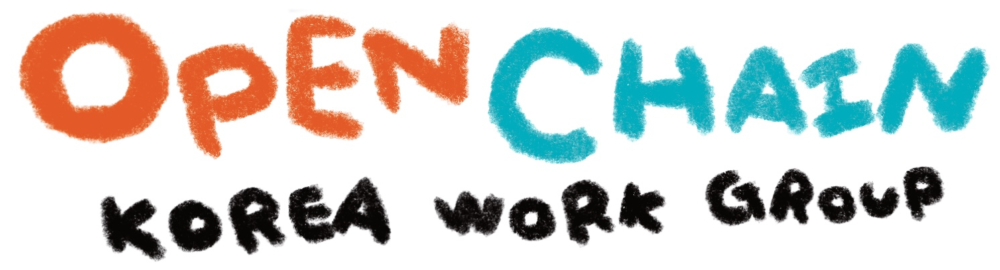

---
title: "About"
linkTitle: "About"
weight: 10
type: docs
description: >
  OpenChain Korea Work Group을 소개합니다.
menu:
  main:
    weight: 10
---

_
 < designed by [@soimkim](https://github.com/soimkim) > 
_

Linux Foundation [OpenChain Project](https://openchainproject.org/)의 Subgroup인 OpenChain KWG(Korea Work Group)은 Open Source 정신인 협업과 공유를 통해 모두가 효과적으로 Open Source Compliance를 달성하기 위한 방법을 고민하고 공유하기 위한 모임입니다!

## 왜 함께 모이나요

Open Source Compliance를 위한 정책 및 프로세스가 이미 구축된 대기업들도 거대하고 복잡한 소프트웨어 공급망을 고려한다면, 아무리 완성도 높은 프로세스가 구축되어 있다고 하더라도 컴플라이언스 리스크에서 벗어나기 어렵습니다. 결국 소프트웨어 공급망 내 모든 기업의 Compliance 수준을 높이는 게 중요합니다. 이를 위해서는 이미 Open Source Compliance에 대해 이해도가 높은 기업들이 가진 자산을 공유하고, 다른 기업에서 쉽게 참가할 수 있도록 안내하는 길잡이를 해야 합니다.

기업이 보유하고 있는 Open Source Compliance에 대한 자산은 경쟁사에 공유한다고 해도 매출에 악영향을 미치지 않습니다. 반대로, 경쟁사의 Open Source Compliance 정책을 알아낸다고 해도 이를 기업의 이익 증대와 연결할 수 없습니다. 기업이 Open Source Compliance에 대한 Best Practice를 서로 공유한다면, 각 기업은 적은 비용과 리소스만을 투입해도 상당 수준의 Compliance를 달성하는 데 큰 효과를 얻을 수 있습니다.

국내 기업들도 이와 같은 아이디어에 공감해 지난 2019년 1월, LG전자, SK텔레콤, 카카오, 현대자동차, 삼성전자의 Open Source 담당자들이 참여한 첫 번째 OpenChain KWG(Korea Work Group) 모임이 개최되었습니다.

## 무엇을 하나요

- [정기 미팅](../meeting/): 분기마다 참여 기업이 돌아가며 모임을 열고, 오픈소스 관리 사례와 경험을 발표합니다.
- [가이드](../guide/): ISO/IEC 5230, ISO/IEC 18974 등 국제표준을 실무에 적용하는 방법을 정리해 공개합니다.
- [자료](../resource/): OpenChain Project의 규격과 자료를 한국어로 번역해 공개합니다.
- [서브그룹](../subgroup/): 운영위원회와 주제별 그룹이 세부 활동을 이어 갑니다.

## 어떻게 참여하나요

1. [메일링 리스트](subscribe/)에 가입합니다. 오픈소스 컴플라이언스 업무를 하는 분이라면 누구나 가입할 수 있습니다.
2. 메일로 정기 미팅 공지와 참가 신청 안내를 받고, 미팅에 참석합니다.
3. 멤버가 되면 [Discord](https://discord.com/channels/1177116701561729104/)에서 다른 멤버들과 대화할 수 있습니다.

처음 참여하신다면 [웰컴 패키지](welcomepackage/)에서 활동 방식을 먼저 살펴보세요.
