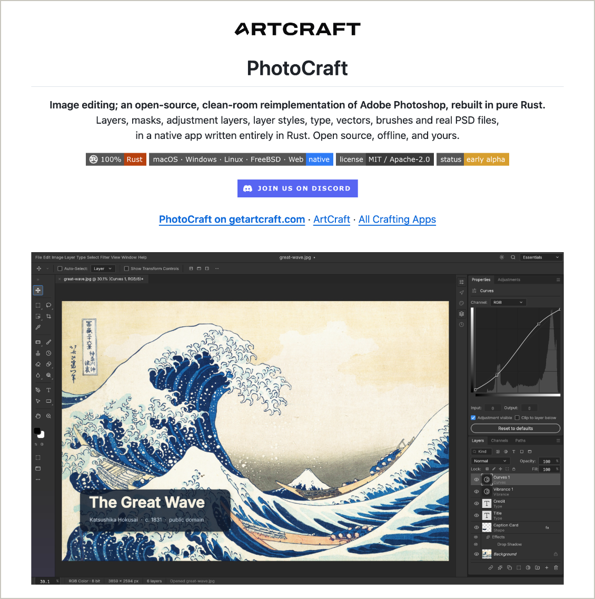
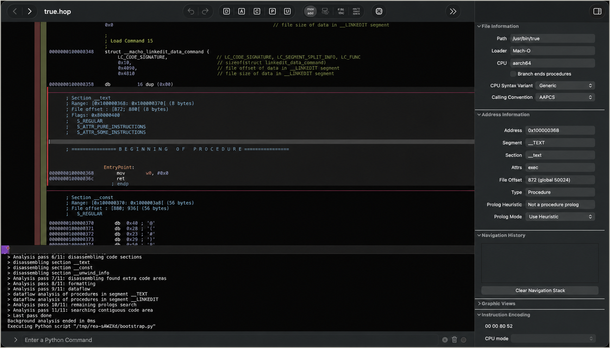
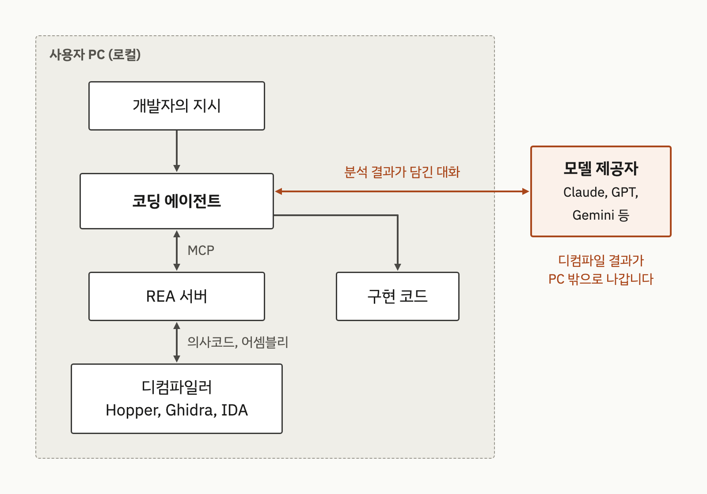
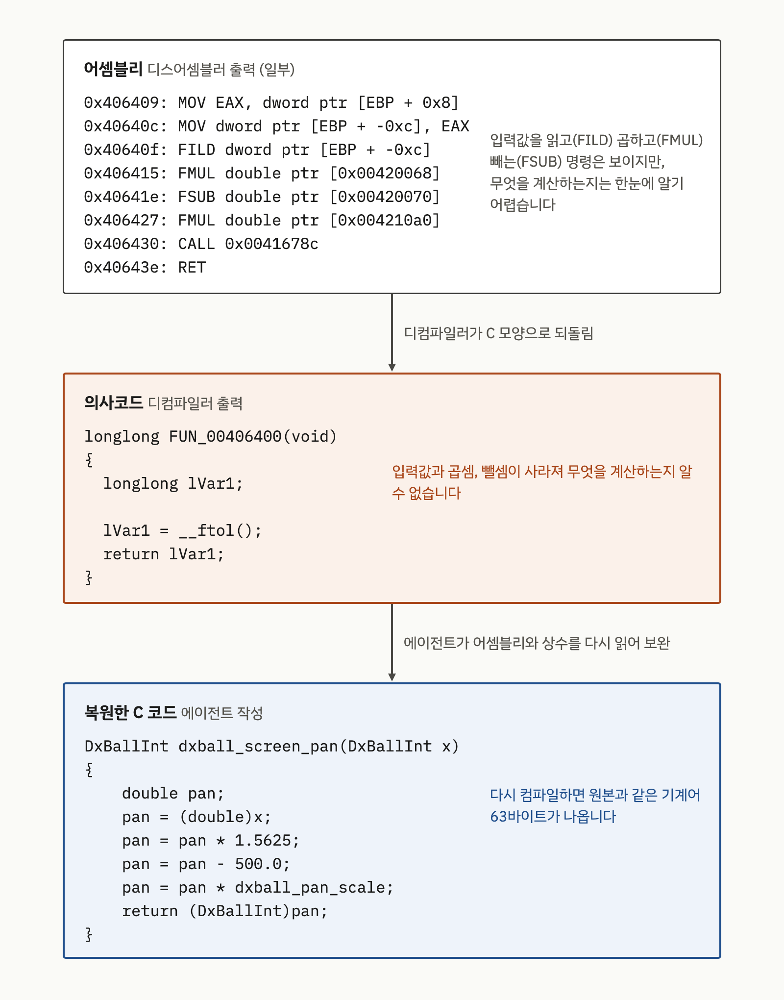
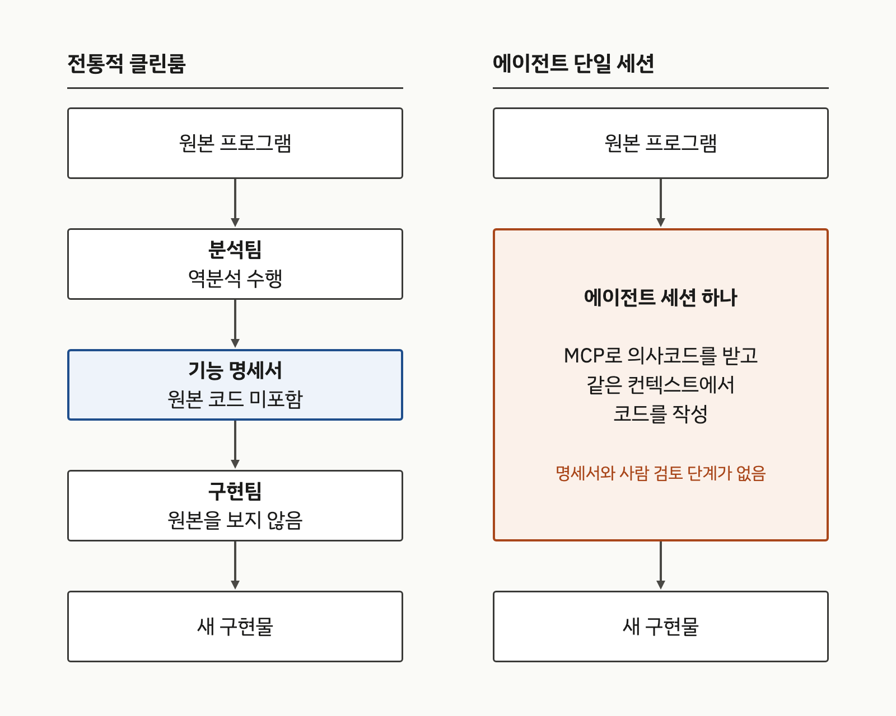
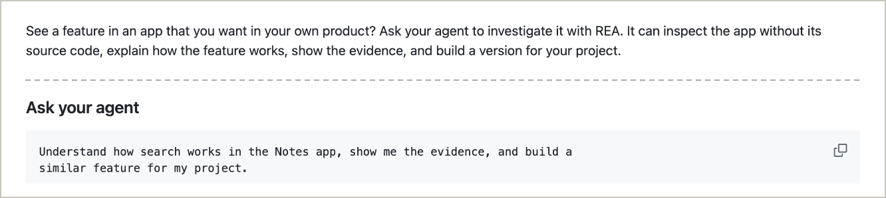
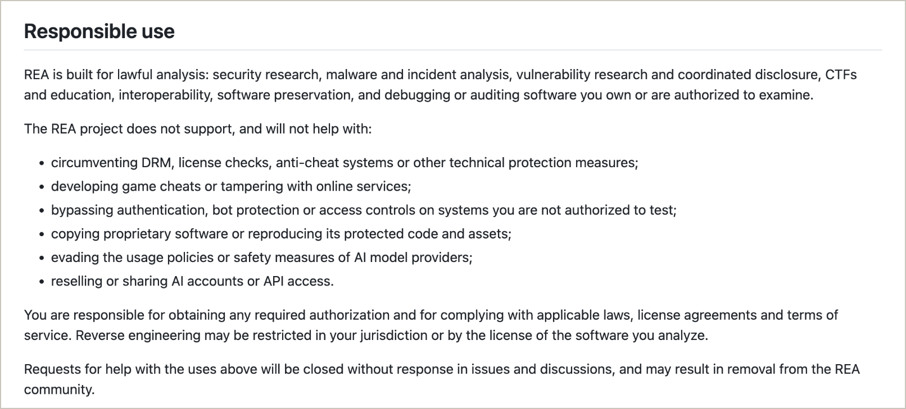
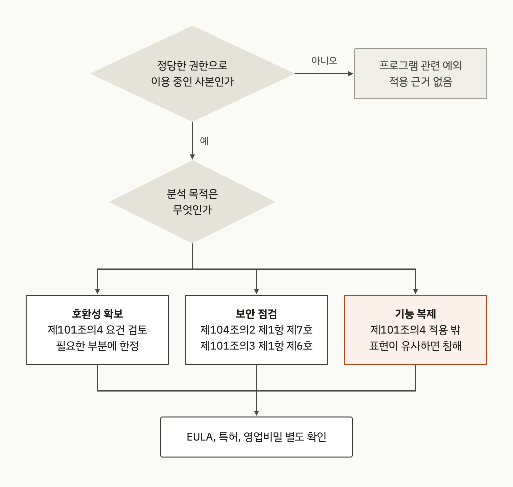
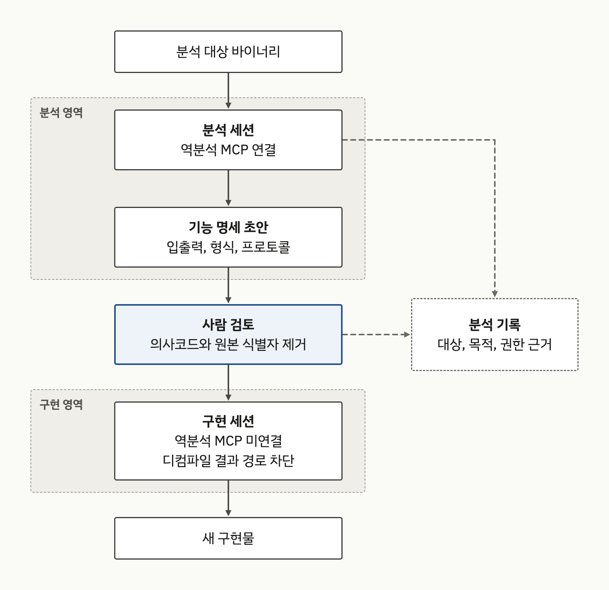

{}
이 글은 Claude Code를 이용해 작성했고, 인용한 핵심 사실은 1차 출처로 교차 검증했습니다.
{}

AI 코딩 에이전트에 디컴파일러를 연결해 주는 도구가 빠르게 퍼지고 있습니다. 그중 하나인 REA(Reverse Engineer Anything)는 에이전트가 소스 코드 없이 앱을 살펴보고 그 기능의 동작을 설명한 뒤 "사용자의 프로젝트에 맞는 버전"까지 만들 수 있다고 소개합니다[E3](#e3). 한국 저작권법은 프로그램코드역분석을 호환에 필요한 정보를 얻는 목적으로만 허용하므로[A1](#a1), 같은 도구라도 호환성 확보, 보안 점검, 기능 복제 중 무엇에 사용하느냐에 따라 법적 판단이 달라집니다. 기업이 이런 도구를 허용하려면 분석 목적 확인, 분석 세션과 구현 세션의 분리, 분석 기록, 디컴파일러 라이선스 확인을 사내 기준에 넣어야 합니다.

## 1. AI로 상용 앱을 다시 만든다는 사례들

2026년 들어 상용 앱을 공개 소프트웨어로 다시 구현했다거나 그런 일을 대신해 준다는 프로젝트가 잇달아 주목을 받았습니다. 주장이 얼마나 사실로 확인되는지는 사례마다 다릅니다.

ArtCraft는 GitHub Organization storytold 아래에서 Craft 계열 앱을 공개하는 프로젝트이고[F8](#f8), 그중 PhotoCraft는 Adobe Photoshop을 다시 구현했다고 내세웁니다. 2026-09-30에 만들어진 저장소의 README는 이 프로젝트를 "clean-room reimplementation of Adobe Photoshop"이라고 소개하고, 공개 명세와 관찰한 동작("public specs and observed behaviour only")만 근거로 삼았으며 독점 코드, 셰이더, 에셋은 사용하지 않았다고 밝힙니다(그림 1)[F7](#f7). README 스스로 아직 "early alpha" 단계라 전문 작업용 대체품은 아니라고 적지만, 독일 매체 cloudmagazin은 10월 2일부터 7일 사이에 네 개 버전이 잇달아 나왔다고 보도했고[F13](#f13), KDnuggets는 이를 "AI 소프트웨어 복제" 흐름의 사례로 다뤘습니다[F14](#f14).

클린룸은 프로젝트가 스스로 붙인 설명입니다. 저장소는 개발에 어떤 AI 모델이나 역분석 도구를 사용했는지 밝히지 않고, 클린룸 주장을 제3자가 검증한 기록도 이번 조사에서는 찾지 못했습니다. 이런 결과물을 사내에 들여오거나 참고하려는 기업은 "클린룸으로 만들었다"는 문구만으로 원본 권리 문제가 해결되었다고 판단할 수 없습니다.

**그림 1.** PhotoCraft 저장소 README 상단. "clean-room reimplementation of Adobe Photoshop" 문구와 앱 실행 화면 *(storytold/photocraft[F7](#f7), 2026-10-14 캡처)*

MALUS(malus.sh)는 "Clean Room as a Service"를 내건 사이트입니다(그림 2). 자사 AI가 어떤 오픈소스 프로젝트든 처음부터 다시 만들어 주므로, 결과물은 출처 표시나 카피레프트 의무 없이 사용할 수 있다고 홍보합니다[F9](#f9). 오픈소스 라이선스 의무를 AI 재작성으로 지워 준다는 주장입니다.

다만 실제 서비스라기보다 문제 제기로 보입니다. 사이트의 CEO 서한은 Mike Nolan 명의인데, 그는 FOSDEM 2026에서 "Let's end open source together with this one simple trick"이라는 발표를 공동으로 한 사람입니다[F9](#f9)·[F10](#f10). 사이트에는 등록 관할을 "[JURISDICTION WITHHELD]"로 가린 표기처럼 풍자로 읽히는 요소가 여럿 있고, 확인일 현재 서비스가 일시 중단되었다는 문구가 표시됩니다. 실제로 주문을 받아 결과물을 납품했는지는 1차 기록으로 확인되지 않았습니다[F9](#f9). 풍자라 하더라도 이런 사이트가 나왔다는 것은 AI 재작성으로 라이선스 의무를 피하는 일이 현실적인 걱정거리가 되었다는 뜻이고, 4장의 chardet 사례는 그 걱정이 실제 분쟁이 된 경우입니다.

**그림 2.** MALUS 사이트 첫 화면. 처리 건수 같은 숫자는 사이트가 표시한 값이며 확인되지 않음 *(malus.sh[F9](#f9), 2026-10-14 캡처)*

PhotoCraft와 MALUS에 대해 법원 판단이 나온 것은 이번 조사에서 확인되지 않았습니다. 그래도 "AI가 분석하고 AI가 다시 작성한다"는 작업 방식이 오픈소스 관리자의 검토 대상으로 들어온 것은 분명합니다.

이런 흐름과 함께 주목받은 분석 도구가 REA입니다. 재구현 결과물이나 대행 서비스가 아니라 에이전트에 연결해 사용하는 역분석 도구이고, 2장에서 보듯 같은 방식의 도구가 여럿 있으므로 아래 논의는 이 계열 도구 전체에 해당합니다. 저장소는 2026-04-14에 생성된 MIT 라이선스 프로젝트이며, 2026-10-14 GitHub API 기준 Star가 21만 개를 넘습니다[E1](#e1). 생성 반년 만에 이만큼 모였다는 것은 관심이 크다는 뜻이지만, Star는 관심의 지표일 뿐 실제 도입 규모나 품질을 뜻하지는 않습니다.

## 2. 에이전트 역분석 도구가 바꾸는 개발 흐름

REA는 MCP(Model Context Protocol) 서버로 코딩 에이전트에 연결됩니다. README의 설명에 따르면 에이전트가 MCP로 REA를 호출해 대상을 점검하고, REA가 근거와 함께 결과를 돌려주며, 에이전트가 그 결과로 동작을 설명하거나 구현을 작성하고 테스트합니다. 네이티브 분석의 결과물은 어셈블리와 의사코드이고, 심층 분석에는 Hopper, Ghidra, IDA 중 하나를 엔진으로 사용합니다[E3](#e3). 분석 자체는 로컬에서 실행되지만, 그 결과를 읽는 것은 에이전트이고 에이전트 뒤의 모델 제공자에게는 그 제공자의 데이터 정책("its own data policy")이 적용된다고 README가 직접 적고 있습니다[E3](#e3). REA가 로컬 도구라도 분석 결과는 PC 밖으로 나갈 수 있다는 뜻입니다.

Hopper, Ghidra, IDA는 디스어셈블러이자 디컴파일러입니다. 배포된 실행 파일에는 CPU가 읽는 숫자 덩어리인 기계어만 들어 있습니다. 디스어셈블러는 이 기계어를 `MOV`, `FMUL` 같은 명령어 기호로 바꿔 보여 주고(어셈블리), 디컴파일러는 한 단계 더 나아가 C 언어와 비슷한 모양의 코드로 되돌립니다. 이렇게 되돌린 코드를 의사코드(슈도코드, pseudocode)라고 부릅니다. 원래 소스 코드가 아니라 기계어에서 추정해 만든 코드라서 변수 이름과 주석은 사라지고 `FUN_00406400` 같은 기계적인 이름이 붙으며, 빠지거나 틀린 부분도 생깁니다. 같은 함수가 어셈블리, 의사코드, 사람이 읽을 수 있게 복원한 C 코드로 각각 어떻게 보이는지는 아래 DX-Ball 사례(그림 5)에서 볼 수 있습니다.

Ghidra는 미국 국가안보국(National Security Agency, NSA)이 공개한 오픈소스 도구이고[D8](#d8), IDA는 Hex-Rays의, Hopper는 Cryptic Apps의 상용 제품입니다[D2](#d2)·[D7](#d7). REA가 직접 디컴파일하지는 않습니다. 이 도구 안에서 분석 스크립트를 실행해 결과를 받아 오고(그림 3), 에이전트는 그 결과를 읽습니다. JavaScript나 Electron 앱은 코드가 앱 패키지 안에 남아 있으므로 이런 엔진 없이 분석합니다[E3](#e3).

**그림 3.** REA가 Hopper에서 macOS의 `/usr/bin/true`를 분석하는 화면. 하단 로그에 REA가 실행한 스크립트가 보임 *(morluto/rea README 수록 이미지, 커밋 877d404[E3](#e3))*

**그림 4.** 에이전트 역분석 도구의 연결 구조 *(REA README의 동작 설명[E3](#e3)을 바탕으로 작성, 2026-10-14)*

그림 4의 모델 제공자는 코딩 에이전트가 사용하는 대규모 언어 모델(Large Language Model, LLM) 서비스입니다. REA가 설정을 지원하는 에이전트를 예로 들면 Claude Code는 Anthropic의 Claude, Codex는 OpenAI의 모델, Gemini CLI는 Google의 Gemini를 사용합니다[E3](#e3). 그림 4에서 눈여겨볼 지점은 두 곳입니다. 디컴파일 결과가 에이전트의 컨텍스트에 들어가는 순간 외부 모델 제공자에게도 전달되고, 같은 컨텍스트에서 구현 코드가 나옵니다. 앞의 것은 6장의 디컴파일러 약관 문제로, 뒤의 것은 바로 아래의 클린룸 문제로 이어집니다.

디컴파일러를 AI 에이전트에 연결하는 방식은 REA만의 것이 아니고, REA 이전부터 있었습니다. 개인 개발자가 만든 Ghidra용 GhidraMCP와 IDA Pro용 ida-pro-mcp는 2025년 3월에 저장소가 생겼고[E9](#e9)·[E10](#e10), 2026년에는 디컴파일러 회사가 직접 공식 MCP 서버를 내놓기 시작했습니다. IDA를 만드는 Hex-Rays가 2026-09-25에 공식 MCP 서버를 발표했고[E13](#e13), Hopper와 Android 앱 디컴파일러 JEB도 MCP 서버를 제공한다고 밝힙니다[D7](#d7)·[D10](#d10). 회사가 이미 라이선스를 구매해 사용하는 디컴파일러에 이 기능이 들어 있다면, REA 같은 도구를 따로 설치하지 않아도 에이전트가 디컴파일 결과를 읽을 수 있다는 뜻입니다.

Hex-Rays가 발표하면서 붙인 경고도 눈여겨볼 만합니다. 이 서버는 외부 AI 시스템과 통신하므로 모든 조직의 보안 정책에 맞지는 않을 수 있고, 신뢰할 수 없는 데이터를 다룰 때는 샌드박스에서 실행하라고 권고했습니다[E13](#e13). 도구를 만든 회사도 분석 내용이 외부 모델로 나가는 것을 위험 요소로 본다는 뜻이고, 그림 4에서 짚은 지점과 같습니다. 그래서 6장의 관리 기준은 특정 도구 이름이 아니라 디컴파일러를 에이전트에 연결하는 기능 전체를 대상으로 합니다.

### 실제로는 어떻게 동작할까

REA 공식 사이트의 사례 하나를 따라가 보면 흐름이 구체적으로 보입니다. 1996년 Windows 게임 DX-Ball을 실행 파일로부터 유지보수 가능한 C 코드로 다시 만드는 프로젝트의 한 단계이고, 사례 페이지가 예로 든 지시는 "Use REA to find how DX-Ball calculates sound panning. Explain the calculation and show the code."입니다[E14](#e14).

- 에이전트가 REA의 `analyze_function`으로 주소 `0x406400`의 함수를 분석했습니다. 디컴파일러가 내놓은 첫 의사코드는 입력이 없는 함수로 보여 계산식을 알 수 없었습니다.
- 에이전트는 어셈블리 명령을 직접 읽어 숨은 입력을 찾았고, 이 함수를 부르는 쪽(`0x411f40`)을 분석해 그 입력이 벽돌의 화면 x좌표라는 것을 확인했습니다.
- `read_bytes`로 실행 파일 안의 상수 1.5625와 500.0을 읽었습니다.
- 이를 바탕으로 C 함수 `dxball_screen_pan`을 작성하고 원본과 3,205가지 경우의 결과를 비교했습니다. 당시 컴파일러(VC4.0)로 다시 컴파일하면 원본 함수와 같은 기계어 63바이트가 나온다고 사례 페이지는 밝힙니다.

**그림 5.** DX-Ball의 같은 함수를 세 단계로 본 모습. 디컴파일러의 의사코드에서 빠진 계산을 에이전트가 어셈블리와 상수로 보완함 *(REA 사례 페이지[E14](#e14)의 코드를 옮겨 작성, 2026-10-14)*

디컴파일러의 의사코드는 출발점일 뿐이고, 빈 곳은 에이전트가 어셈블리와 상수를 오가며 메웠습니다. 마지막 단계는 이 글의 주제와 직접 관련됩니다. 원본과 같은 기계어가 나오도록 맞춘 코드는 기능만 참고해 새로 작성한 코드가 아니라 원본 표현을 되살린 코드이고, 3장에서 다룰 "표현이 실질적으로 유사한 프로그램"인지를 바로 이런 결과물에서 따지게 됩니다.

같은 사이트의 Notion 사례는 상용 앱의 기능을 추적한 경우입니다. 에이전트는 Notion 데스크톱 앱에 패키지된 JavaScript를 분석해, 복사한 텍스트와 HTML이 시스템 클립보드에 쓰이기까지의 호출 경로를 단계별 코드와 함께 보여 줬습니다[E15](#e15). 이 사례 페이지는 분석 권한을 언급하지 않습니다.

### 클린룸 관행과 부딪히는 지점

분석과 구현이 한 세션에서 이어지는 구조는 기존 클린룸 관행과 부딪힙니다. 클린룸 설계는 원본을 분석하는 팀과 구현하는 팀을 나누고, 구현팀은 원본 대신 기능 명세서만 보고 작업하는 방식입니다[F18](#f18). 반면 에이전트 세션에서는 디컴파일 결과를 받은 바로 그 컨텍스트에서 구현 코드가 작성됩니다. 분석과 구현 사이에 사람이 검토한 명세서라는 차단 단계가 없으므로, 나중에 "원본 표현을 보지 않고 만들었다"고 설명할 근거가 남지 않습니다.

**그림 6.** 전통적 클린룸과 에이전트 단일 세션의 정보 흐름 비교 *(REA README의 동작 설명[E3](#e3)을 바탕으로 작성, 2026-10-14)*

REA 문서도 이 위험을 언급합니다. DISCLAIMER는 보안 연구, 취약점 연구와 조정된 공개, 상호운용성, 소프트웨어 보존, 본인 소유이거나 권한을 받은 소프트웨어의 감사를 허용 목적으로 들고, "copying proprietary software or reproducing its protected code and assets"는 지원하지 않는다고 명시합니다[E4](#e4). 같은 문서는 소스와 비슷한 출력을 얻어도 원본에 대한 권리가 생기지 않으며, 역분석이 관할권이나 대상 소프트웨어의 라이선스에 따라 제한될 수 있다고 적습니다[E4](#e4). README도 IDA Pro, Hopper, JEB 같은 상용 도구를 합법적으로 취득해야 하고 크랙본과 라이선스 우회는 허용하지 않는다고 밝힙니다[E3](#e3).

한편 README 첫 문단의 "build a version for your project"와 DISCLAIMER의 비지원 항목 사이에서 어느 수준의 재구현이 어느 쪽에 속하는지 가르는 기준은 두 문서 어디에도 없습니다[E3](#e3)·[E4](#e4). 그 판단은 사용자에게 맡겨져 있고, DISCLAIMER도 에이전트에게 지시한 행동의 책임이 사용자에게 있다고 적습니다[E4](#e4). 그래서 기업은 사내 기준을 따로 세워야 합니다.

**그림 7.** REA README의 소개 단락과 예시 지시문. 가운데 설치 안내는 생략 *(morluto/rea README.md, 커밋 877d404[E3](#e3), 2026-10-14 캡처)*

**그림 8.** REA DISCLAIMER의 Responsible use 절 *(morluto/rea DISCLAIMER.md, 커밋 877d404[E4](#e4), 2026-10-14 캡처)*

그림 7의 예시 지시문은 Notes 앱의 검색 기능을 분석해 "similar feature"를 만들어 달라는 내용입니다. 그림 8의 넷째 항목과 나란히 놓고 보면, 기능을 분석해 비슷하게 만드는 것과 보호받는 코드를 재현하는 것 사이의 경계를 사용자가 스스로 그어야 한다는 점이 드러납니다.

## 3. 한국 저작권법으로 본 목적별 판정

### 법이 허용하는 역분석의 범위

현행 저작권법(법률 제21336호, 2026-08-11 시행)은 역분석의 정의에 목적을 넣어 두었습니다[A1](#a1).

> **제2조 제34호** "프로그램코드역분석"은 독립적으로 창작된 컴퓨터프로그램저작물과 다른 컴퓨터프로그램과의 호환에 필요한 정보를 얻기 위하여 컴퓨터프로그램저작물코드를 복제 또는 변환하는 것을 말한다.

허용 요건과 정보 이용 제한은 제101조의4에 있습니다[A1](#a1).

> **제101조의4(프로그램코드역분석)**
>
> ① 정당한 권한에 의하여 프로그램을 이용하는 자 또는 그의 허락을 받은 자는 호환에 필요한 정보를 쉽게 얻을 수 없고 그 획득이 불가피한 경우에는 해당 프로그램의 호환에 필요한 부분에 한정하여 프로그램의 저작재산권자의 허락을 받지 아니하고 프로그램코드역분석을 할 수 있다.
>
> ② 제1항에 따른 프로그램코드역분석을 통하여 얻은 정보는 다음 각 호의 어느 하나에 해당하는 경우에는 이를 이용할 수 없다.
>
> **제1호** 호환 목적 외의 다른 목적을 위하여 이용하거나 제3자에게 제공하는 경우
>
> **제2호** 프로그램코드역분석의 대상이 되는 프로그램과 표현이 실질적으로 유사한 프로그램을 개발ㆍ제작ㆍ판매하거나 그 밖에 프로그램의 저작권을 침해하는 행위에 이용하는 경우

제1항의 요건은 네 가지이고 모두 충족해야 합니다. 정당한 권한을 가진 이용자일 것, 호환 정보를 쉽게 얻을 수 없을 것, 획득이 불가피할 것, 호환에 필요한 부분에 한정할 것입니다. 기능 조사에 관해서는 제101조의3 제1항 제6호가 따로 있습니다. 같은 항은 "그 목적을 위하여 필요한 범위에서 공표된 프로그램을 복제 또는 배포할 수 있다"고 하면서, 저작재산권자의 이익을 부당하게 해치는 경우는 제외합니다[A1](#a1).

> **제101조의3 제1항 제6호** 프로그램의 기초를 이루는 아이디어 및 원리를 확인하기 위하여 프로그램의 기능을 조사ㆍ연구ㆍ시험할 목적으로 복제하는 경우(정당한 권한에 따라 프로그램을 이용하는 자가 해당 프로그램을 이용 중인 경우로 한정한다)

이 조항은 역분석 조항과 달리 호환 목적이 아니어도 됩니다. 대신 허용되는 것은 아이디어와 원리를 확인하기 위한 복제이고, 그 프로그램을 정당하게 이용하고 있어야 합니다. 동작 원리를 이해하는 데까지는 이 조항을 근거로 삼을 수 있지만, 그 결과를 제품 코드로 옮기는 단계는 이 조항이 다루지 않습니다.

기술적 보호조치가 걸려 있으면 제104조의2가 함께 적용됩니다. 기술적 보호조치는 암호화나 라이선스 검사처럼 무단 이용을 막으려고 저작물에 걸어 둔 장치를 말합니다. 이런 장치를 풀어야 분석할 수 있는 프로그램이라면, 역분석이 허용되는 경우에도 이 조항을 따로 따져야 합니다. 제1항 본문은 "누구든지 정당한 권한 없이 고의 또는 과실로 제2조제28호가목의 기술적 보호조치를 제거ㆍ변경하거나 우회하는 등의 방법으로 무력화하여서는 아니 된다"이고, 역분석과 관련된 예외는 다음 세 호입니다[A1](#a1).

> **제104조의2 제1항 제1호** 암호 분야의 연구에 종사하는 자가 저작물등의 복제물을 정당하게 취득하여 저작물등에 적용된 암호 기술의 결함이나 취약점을 연구하기 위하여 필요한 범위에서 행하는 경우. 다만, 권리자로부터 연구에 필요한 이용을 허락받기 위하여 상당한 노력을 하였으나 허락을 받지 못한 경우로 한정한다.
>
> **제104조의2 제1항 제6호** 정당한 권한을 가지고 프로그램을 사용하는 자가 다른 프로그램과의 호환을 위하여 필요한 범위에서 프로그램코드역분석을 하는 경우
>
> **제104조의2 제1항 제7호** 정당한 권한을 가진 자가 오로지 컴퓨터 또는 정보통신망의 보안성을 검사ㆍ조사 또는 보정하기 위하여 필요한 경우

벌칙도 가볍지 않습니다. 제136조 제1항은 저작재산권 등을 "복제, 공연, 공중송신, 전시, 배포, 대여, 2차적저작물 작성의 방법으로 침해한 자는 7년 이하의 징역 또는 1억원 이하의 벌금에 처하거나 이를 병과(倂科)할 수 있다"고 정하고, 같은 조 제3항 제3호의3은 "업으로 또는 영리를 목적으로 제104조의2제1항 또는 제2항을 위반한 자"를 3년 이하의 징역 또는 3천만원 이하의 벌금에 처합니다[A1](#a1). 제124조 제1항 제3호는 "프로그램의 저작권을 침해하여 만들어진 프로그램의 복제물을 그 사실을 알면서 취득한 자가 이를 업무상 이용하는 행위"를 침해로 봅니다[A1](#a1). 크랙본임을 알고 구한 디컴파일러를 업무에 사용하면 이 조항에 해당하고, 제136조 제3항 제4호에 따라 3년 이하의 징역 또는 3천만원 이하의 벌금 대상이 됩니다[A1](#a1).

### 목적별로 나눠 보면

조문을 세 가지 목적에 대입한 결과는 그림 9와 표 1과 같습니다. 두 자료는 조문 대조에서 나온 정리이며, 개별 사안에 대한 법률 판단을 대신하지 않습니다.

**그림 9.** 분석 목적에 따른 저작권법 판정 흐름 *(저작권법 제101조의3, 제101조의4, 제104조의2[A1](#a1)를 바탕으로 작성, 2026-10-14)*

| 목적 | 근거 조문 | 판정 요지 | 확인되지 않은 쟁점 |
|---|---|---|---|
| 호환성 확보 | 제2조 제34호, 제101조의4, 제104조의2 제1항 제6호 | 네 요건을 갖추면 허락 없이 가능. 얻은 정보는 호환 목적에만 사용하고, 표현이 실질적으로 유사한 프로그램 개발에 사용할 수 없음 | EULA의 역분석 금지 조항이 국내에서 효력을 갖는지에 관한 판례 |
| 보안 점검 | 제104조의2 제1항 제7호(암호 연구는 제1호), 제101조의3 제1항 제6호 | 보호조치 무력화는 "오로지" 보안성 검사일 때 예외. 코드 복제 자체의 근거는 제6호 해석에 의존 | 제6호의 "복제"가 디컴파일·디스어셈블까지 포함하는지에 관한 해석·판례 |
| 기능 복제 | 제101조의4 제2항, 제136조 제1항 | 호환 목적 역분석 예외의 범위 밖. 원본과 표현이 실질적으로 유사하면 침해 | 에이전트 단일 세션 구현을 클린룸으로 인정할 기준(이번 조사에서 판례를 찾지 못함) |

**표 1.** 목적별 판정 요약 *(저작권법[A1](#a1), 2026-10-14 기준. 법률 자문이 아닌 조문 정리)*

호환성 확보는 법이 역분석을 허용한 본래 목적입니다. 예를 들어 사내 시스템이 공개 문서가 없는 상용 장비의 데이터 형식을 읽어야 하는 경우입니다. 실무에서는 요건 중 "쉽게 얻을 수 없고"를 자주 놓칩니다. 벤더에게 인터페이스 문서를 요청했는지, 공개 API로 해결되지 않는지를 먼저 확인한 기록이 있어야 요건 충족을 설명할 수 있습니다.

보안 점검은 조문이 둘로 나뉩니다. 보호조치 우회는 제104조의2 제1항 제7호가 다루고, 코드를 디컴파일해 읽는 복제 행위는 제101조의3 제1항 제6호로 설명할 수 있습니다. 제6호가 디컴파일에까지 미치는지를 다룬 국내 해석이나 판례는 이번 조사에서 확인하지 못했습니다. 일반 공정이용 조항(제35조의5)을 근거로 삼을 여지도 남아 있습니다[A1](#a1). 자사 제품이나 계약으로 점검 권한을 받은 제품을 분석하는 경우는 권리자 허락이 있으므로 이 쟁점과 관계가 없습니다.

기능 복제가 가장 위험합니다. 타사 앱의 기능을 보고 "비슷한 것을 만들어 달라"고 에이전트에게 지시하는 작업은 호환 목적이 아니므로 제101조의4의 보호를 받지 못합니다. 제101조의3 제1항 제6호가 아이디어와 원리를 확인하기 위한 복제를 허용하므로, 조문만 보면 기능의 원리를 이해하는 것 자체는 금지되지 않는다고 해석할 수 있습니다. 문제는 결과물입니다. 에이전트가 의사코드를 보고 작성한 코드가 원본과 표현이 실질적으로 유사하면 침해가 되고, 그림 6에서 본 단일 세션 구조에서는 유사하지 않다는 근거를 남기기 어렵습니다.

### 해외 제도와의 비교

| 항목 | 한국 | EU | 미국 |
|---|---|---|---|
| 호환 목적 역분석 | 제101조의4 | 지침 2009/24/EC 제6조 | 판례상 공정이용, 17 U.S.C. §1201(f) |
| 기능 관찰·연구 | 제101조의3 제1항 제6호(복제) | 제5조 제3항(관찰·연구·시험) | 판례상 공정이용 |
| EULA로 역분석을 금지하면 | 효력에 관한 명문 규정 없음 | 금지 조항은 무효(제8조) | 금지 조항을 유효로 본 판결 있음(Bowers) |
| 보안 점검 목적 우회 | 제104조의2 제1항 제7호 | 지침에서 확인하지 못함 | §1201(j), 37 CFR §201.40(b)(18) |

**표 2.** 역분석 관련 제도 비교 *(각 법령·판례[A1](#a1)·[A3](#a3)·[A4](#a4)·[A6](#a6)·[B1](#b1)·[B3](#b3), 2026-10-14 기준)*

EU 컴퓨터 프로그램 지침 2009/24/EC 제6조는 디컴파일 허용 요건으로 권한 있는 이용자, 상호운용 정보를 미리 쉽게 얻을 수 없을 것, 필요한 부분에 한정할 것을 두고, 얻은 정보를 "substantially similar in its expression" 프로그램 개발에 사용하지 못하게 합니다[A3](#a3). 조문을 대조해 보면 한국 제101조의4와 구조가 거의 같습니다. 차이는 계약입니다. 제8조 둘째 문단은 "Any contractual provisions contrary to Article 6 or to the exceptions provided for in Article 5(2) and (3) shall be null and void."라고 정합니다[A3](#a3). EULA에 역분석 금지 조항을 넣어도 EU에서는 법이 허용한 범위의 디컴파일까지 막을 수 없다는 뜻입니다. 한국 저작권법 제101조의3과 제101조의4에는 이와 같은 문구가 없으며[A1](#a1), 다른 법리로 같은 효과를 인정한 국내 판례도 확인하지 못했습니다.

미국은 법 조항보다 판례로 기준을 정했습니다. Sega Enterprises Ltd. v. Accolade, Inc.(9th Cir. 1992)는 Sega 게임기와 호환되는 게임을 만들려고 Sega의 프로그램을 디스어셈블한 행위를, 호환에 필요한 정보를 얻을 방법이 그것뿐이었고 정당한 이유도 있었으므로 공정이용으로 보았습니다[B1](#b1). Sony Computer Entertainment, Inc. v. Connectix Corp.(9th Cir. 2000)도 PlayStation 호환 에뮬레이터를 개발하는 과정에서 생긴 복제를 공정이용으로 인정했습니다[B2](#b2). 두 판결이 허용한 것은 분석 과정의 복제이고, 그렇게 만든 최종 제품이 원본을 침해하는지는 따로 따집니다. 한국 제101조의4 제2항 제2호와 같은 구분입니다. 법령으로는 17 U.S.C. §1201(f)가 상호운용을 위한 보호조치 우회를, §1201(j)가 소유자나 운영자의 승인을 받은 보안 검사를 예외로 둡니다[A4](#a4).

계약 쪽에는 반대 방향의 판결이 있습니다. Bowers v. Baystate Technologies, Inc.(Fed. Cir. 2003)에서 법원 다수의견은 역분석을 금지한 슈링크랩(shrink-wrap) 라이선스, 곧 포장을 뜯으면 동의한 것으로 보는 약관을 유효하다고 보고 계약 위반 책임을 인정했습니다[B3](#b3). 저작권법이 허용하는 역분석이라도 계약으로 금지했다면 계약 위반이 될 수 있다는 뜻입니다. 반대 의견이 있었고 미국 전체에서 확립된 원칙도 아니지만, 역분석 도구를 사용하기 전에 대상 소프트웨어의 EULA부터 읽어야 하는 이유를 보여 줍니다. 한국에서 같은 문제를 어떻게 판단할지는 아직 정해지지 않았습니다.

### 영업비밀과 특허는 어떻게 볼까

영업비밀 위험은 흔히 말하는 것보다 좁습니다. 부정경쟁방지 및 영업비밀보호에 관한 법률(법률 제21065호, 2026-05-28 시행)이 침해로 보는 취득은 "절취(竊取), 기망(欺罔), 협박, 그 밖의 부정한 수단"에 의한 것이고(제2조 제3호 가목), 같은 호에 역설계나 역분석이라는 단어는 없습니다[A2](#a2). 시중에서 정상적으로 산 제품을 분석하는 데에는 훔치거나 속이는 일이 끼어들 여지가 적으므로, 그것만으로 침해가 되기는 어렵다고 해석할 수 있습니다. 판례가 아니라 조문에 근거한 해석입니다. 미국은 이를 법에 적어 두었습니다. 영업비밀보호법(Defend Trade Secrets Act of 2016, DTSA)으로 개정된 18 U.S.C. §1839(6)(B)는 "improper means"에 "reverse engineering, independent derivation, or any other lawful means of acquisition"이 포함되지 않는다고 명시합니다[A5](#a5). 국내에는 이런 명문 규정이 없고, 역설계를 정당한 취득으로 인정했거나 침해로 본 판례도 이번 조사에서는 확인하지 못했습니다.

예외는 비밀유지 약정을 맺고 받은 바이너리입니다. 이 경우에는 같은 호 라목의 비밀유지 의무 위반 문제가 따로 생기므로 구분해서 다뤄야 합니다[A2](#a2).

특허는 역분석의 적법성과 무관하게 따로 봐야 합니다. 특허법 제94조 제1항은 "특허권자는 업으로서 특허발명을 실시할 권리를 독점한다"고 정하고[A8](#a8), 이 조문에는 독립 개발 여부가 요건으로 들어 있지 않습니다. 저작권법상 문제없이 분석하고 표현을 새로 작성했더라도, 구현한 기능이 특허 청구항에 해당하면 침해가 성립할 수 있습니다.

## 4. chardet 7.0과 무엇이 다른가

AI 재작성이 실제 분쟁이 된 사례는 오픈소스 쪽에서 먼저 나왔습니다. chardet은 텍스트의 문자 인코딩을 알아내는 Python 라이브러리입니다. 관리자 Dan Blanchard는 2026-03-04(UTC) chardet 7.0.0을 내면서 릴리스 노트에 "Ground-up, MIT-licensed rewrite of chardet. Same package name, same public API"라고 적었습니다[F3](#f3). 이전 버전은 LGPL이었습니다. LGPL은 라이브러리를 배포할 때 소스 코드를 함께 제공하도록 요구하는 등 조건이 붙지만 MIT는 저작권 고지만 남기면 되므로, 라이선스가 바뀌면 사용자의 의무가 크게 줄어듭니다. 같은 날 원저작자 Mark Pilgrim은 이슈 #327 "No right to relicense this project"를 열어, 원본 코드에 노출된 상태에서 다시 작성한 것은 클린룸이 아니므로 라이선스 변경은 LGPL 위반이라고 주장했습니다[F2](#f2).

이 논쟁에서 클린룸 주장은 처음부터 약했습니다. Blanchard는 같은 이슈의 pinned comment에서 자신이 원본 코드에 광범위하게 노출되어 전통적 클린룸의 분리를 주장할 수 없다고 인정했고, 다른 참여자는 원본 파일을 가져와 기준으로 삼으라는 지시가 담긴 에이전트 작업 계획 문서의 커밋을 링크했습니다. 그 참여자도 실제 실행 여부는 더 조사하지 않았다고 단서를 달았습니다[F2](#f2). Blanchard는 같은 pinned comment에서 코드 표절 검사 도구 JPlag로 측정한 구조 유사도(직전 릴리스 대비 최대 1.29%)를 독립성의 근거로 제시했으나[F2](#f2), 측정에 사용한 원 리포트는 공개되지 않았습니다.

법률가 의견은 엇갈립니다. GPLv3와 LGPLv3의 공저자인 Richard Fontana는 "I don't currently see any basis for concluding that chardet 7.0.0 is required to be released under the LGPL"이라고 밝혔습니다. 7.0.0을 LGPL로 내야 한다고 볼 근거가 없다는 의견입니다[F5](#f5)·[F6](#f6). Heather Meeker는 2026-04-09 글에서 Fontana의 저작권 분석이 타당할 가능성이 높다고 보면서도, 십수 년 코드를 다뤄 온 관리자에게 클린룸 분리는 성립하기 어렵고, 라이선스 회피만을 위한 재작성은 기술 부채를 낳으며, 같은 이름과 API를 유지한 점이 혼동을 부른다고 지적했습니다[F1](#f1). 둘 다 개인 의견이고 법원 판단은 없습니다. 이슈는 2026-03-26 라이선스를 되돌리지 않은 채 닫혔고[F2](#f2), 2026-10-14 현재 저장소 라이선스는 MIT가 아니라 저작권 고지 의무조차 없는 0BSD로 표시됩니다[F4](#f4).

상용 바이너리를 대상으로 한 역분석은 쟁점이 다릅니다.

| 구분 | chardet 7.0 (오픈소스 재작성) | 상용 바이너리 역분석 |
|---|---|---|
| 원본 접근 | 소스가 공개되어 누구나 읽을 수 있음 | 디컴파일·디스어셈블로 의사코드를 얻어야 함 |
| 주된 쟁점 | 라이선스 의무를 벗어나기 위한 재작성(라이선스 세탁) 여부 | 역분석 행위의 적법성, EULA 위반, 보호조치 우회 |
| 클린룸 주장 | 노출이 공개 기록으로 남아 주장 자체가 어려움 | 분석과 구현의 분리 기록이 있으면 주장 가능 |
| 적용 근거 | 저작권(2차적저작물 여부), 원 라이선스 조건 | 제101조의4, 제104조의2, 계약, 특허 |

**표 3.** 오픈소스 재작성과 상용 바이너리 역분석의 쟁점 비교 *(chardet 기록[F1](#f1)·[F2](#f2)·[F3](#f3)과 저작권법[A1](#a1)을 바탕으로 작성, 2026-10-14)*

공통점도 하나 있습니다. 두 경우 모두 "원본을 본 주체와 구현한 주체가 분리되었는가"가 방어의 중심이 되고, 에이전트 한 세션이 둘을 겸하면 그 분리를 보여 줄 수 없습니다.

## 5. 에이전트가 만든 구현물의 저작권

에이전트가 만든 코드는 회사의 자산으로서도 약할 수 있습니다. Thaler v. Perlmutter는 Stephen Thaler가 자신의 AI 시스템이 스스로 만든 그림을 저작권 등록하려다 거절당해 다툰 사건입니다. 미국 컬럼비아 특별구 연방항소법원은 2025-03-18 저작권법이 인간 저작자를 요구한다며 등록 거절을 유지했고[B4](#b4), 연방대법원은 2026-03-02 상고 신청을 기각했습니다(No. 25-449)[B5](#b5). 대법원이 사건을 심리하지 않기로 한 것이라 대법원 스스로 판단을 내린 것은 아니지만, 항소법원 판결은 그대로 남았습니다. 미국 저작권청의 Part 2 보고서(2025-01)도 순수하게 AI가 생성했거나 표현 요소에 대한 인간의 통제가 불충분한 자료에는 저작권이 미치지 않고, 현재 기술에서 프롬프트만으로는 통제가 충분하지 않다고 결론지었습니다[C1](#c1).

한국도 방향이 같습니다. 문화체육관광부와 한국저작권위원회의 「생성형 인공지능 활용 저작물의 저작권 등록 안내서」(2025-06)는 인간의 창작적 기여가 없는 생성형 AI 산출물은 등록할 수 없고, 프롬프트 입력은 일반적으로 "아이디어 제공 또는 지시 정도"라 창작적 기여로 인정될 가능성이 낮다고 설명합니다. 산출물을 수정·증감한 부분이나 선택·배열에 창작성이 있으면 그 부분은 인정됩니다. 안내서는 컴퓨터프로그램저작물도 같은 기준으로 등록할 수 있다고 적지만 코드 사례는 싣지 않았습니다[C3](#c3).

기업에 주는 시사점은 두 가지입니다. 에이전트가 역분석 결과를 보고 거의 그대로 작성한 구현물은 원본 권리자에게는 침해 시비를 받을 수 있으면서도, 정작 회사가 제3자의 복제를 막을 권리는 약할 수 있습니다. 또 "AI가 새로 작성한 코드이니 우리 소유"라는 설명은 성립하기 어렵습니다. Plagiarism Today가 MALUS의 "legally distinct code that you own outright"라는 문구를 이 이유로 반박한 것도 같은 맥락입니다[F11](#f11).

## 6. 기업 내부 관리 기준은 어떻게 세울까

아래 항목은 앞의 조문과 사례에서 이끌어 낸 이 글의 제안입니다. 조직의 법무 검토를 거쳐 다듬는 것을 전제로 합니다.

### 허용 목적을 목록으로 정해 둡니다

허용 목적은 자사 소유 또는 계약상 점검 권한이 있는 소프트웨어의 디버깅·감사, 보안 점검과 취약점 분석, 공개 문서로 해결되지 않는 호환성 확보 정도로 좁히는 편이 안전합니다. 타사 제품의 기능을 재현하기 위한 분석은 원칙적으로 허용 목록에 넣지 않고, 꼭 필요하면 법무 사전 승인 대상으로 둡니다. REA DISCLAIMER의 허용 목적 목록도 출발점으로 참고할 만합니다[E4](#e4). 다만 도구 문서가 허용한다고 해서 법적 허용이 생기지는 않습니다.

### 클린룸을 에이전트 세션 단위로 나눕니다

분석과 구현을 서로 다른 에이전트 세션으로 분리합니다. 분석 세션은 기능 명세(입출력, 데이터 형식, 프로토콜 동작)만 산출하고, 사람이 그 명세에 의사코드나 원본 식별자가 섞이지 않았는지 검토한 뒤 구현 세션에 넘깁니다. 구현 세션에는 역분석 MCP 서버를 연결하지 않고, 디컴파일 결과 파일이 있는 경로에 접근하지 못하게 설정합니다. chardet 사례에서 작업 계획 문서에 원본 파일을 참조하라는 지시가 남아 있던 것이 그대로 반론의 근거가 되었듯이[F2](#f2), 세션 분리는 설정과 로그로 증명할 수 있어야 의미가 있습니다.

**그림 10.** 에이전트 환경에서 권장하는 세션 분리 구조 *(그림 6의 전통적 클린룸 구조를 에이전트 세션에 옮긴 이 글의 제안, 2026-10-14)*

### 분석 기록을 남깁니다

분석마다 대상 바이너리와 버전, 분석 목적, 권한 근거(구매 증빙, 점검 계약, 제101조의4 요건 검토 메모), 사용한 도구와 라이선스 종류, 산출물 보관 위치를 기록합니다. 호환 목적이라면 벤더에게 인터페이스 정보를 요청한 이력도 함께 남깁니다. "쉽게 얻을 수 없고 그 획득이 불가피한 경우"라는 요건은 이런 기록이 있어야 사후에 설명할 수 있습니다[A1](#a1).

### 디컴파일러 라이선스를 확인합니다

REA 같은 통합 도구는 엔진을 사용자 환경에서 찾아 사용하므로, 어떤 에디션의 디컴파일러가 연결되어 있는지가 곧 계약 문제입니다. REA README는 Hopper 최초 실행 시 데모 모드와 라이선스 활성화 중 하나를 고르는 대화상자가 뜬다고 안내합니다[E3](#e3). 데모를 고르면 아래 표의 데모 제한이 그대로 적용됩니다.

| 도구 | 업무 사용 시 확인할 원문 |
|---|---|
| IDA Free, IDA Home | EULA: Free, Home, Demo License는 "only permitted in a non-commercial environment"[D1](#d1). FAQ: "No, IDA Free is dedicated to non-commercial use only."[D2](#d2) 상업 이용은 IDA Pro만 가능[D2](#d2) |
| Hopper 데모 | "Demo limitations are: No save/export of disassembly or modified binaries, Debugger backend is disabled, Sessions are limited to 30 minutes."[D5](#d5) |
| Binary Ninja Free | "Not for commercial purposes"[D11](#d11). 라이선스: "for your internal evaluation and non-commercial purposes only"[D12](#d12) |
| JEB | "Unless explicitly permitted by the license type (e.g., "JEB Pro OEM"...), you may not publicly distribute, disclose, or make available to third parties any output generated by the Software Product, including but not limited to decompiled code, reconstructed artifacts, and analysis reports."[D9](#d9) |
| Ghidra | Apache License 2.0[D8](#d8) |
| JADX | Apache License 2.0[D13](#d13) |

**표 4.** 주요 디컴파일러의 업무 사용 관련 조건 *(각 벤더 웹 게시본, 2026-10-14 확인)*

IDA Free, IDA Home, Binary Ninja Free는 약관상 상업 환경에서 사용할 수 없으므로[D1](#d1)·[D2](#d2)·[D12](#d12) 업무용 분석 엔진에서 제외합니다. JEB 조항은 에이전트 환경에서 따로 검토가 필요합니다. 디컴파일 출력이 모델 제공자에게 전송되는 구조에서[E3](#e3) 이 전송이 "third parties"에 대한 제공에 해당하는지는 약관 문언만으로 판단하기 어렵기 때문입니다. 표의 문구는 웹 게시본 기준이므로 실제 정책으로 확정할 때는 설치본에 표시되는 약관과 구매 계약서를 대조해야 합니다. 비용과 계약 부담을 줄이려면 Apache 2.0인 Ghidra와 JADX를 사내 기본 엔진으로 두는 방안도 있습니다. 이 경우에도 도구 라이선스가 분석 대상 소프트웨어에 대한 권리를 주지는 않습니다.

### MCP 서버 도입 승인 절차에 넣습니다

역분석 MCP 서버도 다른 MCP 서버와 같은 도입 승인 절차에 넣습니다. MCP 명세는 도구 호출을 임의 코드 실행으로 보고 조심해서 다루라고 하며, Claude Code 같은 에이전트 앱(명세에서는 호스트라고 부릅니다)이 도구를 실행하기 전에 사용자의 명시적 동의를 받도록 정합니다. 그러나 명세 스스로 밝히듯 프로토콜이 이를 강제하지는 못하므로, 실제 통제는 에이전트 앱 설정과 회사 정책에 달려 있습니다[E8](#e8). 역분석 MCP 서버는 분석 대상 프로그램을 실행하거나 연결된 기기를 조작하기도 합니다. REA DISCLAIMER도 "Local operation does not establish authorization", 곧 내 PC에서 실행한다고 분석 권한이 생기지는 않는다고 적습니다[E4](#e4).

그래서 일반 MCP 서버 심사 항목(배포 출처, 권한 범위, 데이터 반출 경로)에 세 가지를 더하는 것이 좋습니다. 무엇을 분석하는 데 사용할 것인지 목적을 확인하고, 연결될 디컴파일러의 에디션과 라이선스를 확인하고, 디컴파일 결과가 외부 모델로 전송되는지 확인합니다. REA처럼 릴리스가 잦은 도구는[E3](#e3) 버전을 고정하고 바꿀 때마다 다시 확인하며, 그 서버로 만든 코드에는 커밋 단위로 AI 사용 사실을 남깁니다.

## 7. 맺음말

에이전트 역분석 도구는 디컴파일러 회사가 공식 기능으로 내놓을 만큼 이미 퍼졌습니다. 개발자가 MCP 서버 하나만 연결하면 사용할 수 있는 환경에서는 도입 자체를 금지하기보다, 어디까지 허용할지를 정해 두는 편이 현실적입니다.

허용 범위를 정하는 기준은 분석이라는 행위보다 목적과 결과물입니다. 호환성 확보와 보안 점검은 저작권법에 근거 조항이 있지만, 타사 기능을 복제하려는 분석은 근거 조항이 없습니다. 결과물이 원본과 표현이 실질적으로 유사하면 침해가 되고, DX-Ball 사례처럼 원본과 같은 기계어가 나오도록 맞춘 코드는 그 판단에서 가장 불리한 쪽에 놓입니다. 에이전트가 분석과 구현을 한 세션에서 처리하면 유사하지 않다는 근거를 남기기도 어렵습니다.

기업이 먼저 할 일은 세 가지입니다. 허용 목적을 목록으로 정하고, 사내에서 사용하는 디컴파일러의 에디션과 약관을 확인하고(IDA Free처럼 상업 이용이 금지된 에디션이 업무에 연결되어 있지 않은지), 분석 세션과 구현 세션을 나눠 그 사실을 기록으로 남기는 것입니다. EULA의 역분석 금지 조항이 국내에서 효력이 있는지, 제101조의3 제1항 제6호가 디컴파일까지 허용하는지는 아직 판례로 정해지지 않았으므로, 이 두 쟁점은 사안마다 법무와 함께 판단하고 관련 판례가 나오면 기준을 다시 확인해야 합니다.

## 참고 자료

### A. 법령·규제 원문

**A1.** 대한민국 국회 (2026-02-10 공포, 2026-08-11 시행). *저작권법* (법률 제21336호). 국가법령정보센터. <https://www.law.go.kr/법령/저작권법> - *용도: 제2조 제34호, 제35조의5, 제101조의3, 제101조의4, 제104조의2, 제124조 제1항 제3호, 제136조.* <a href="#a1-ref-1" onclick="event.preventDefault(); history.back(); return false;" title="본문으로 돌아가기">↩</a>

**A2.** 대한민국 국회 (2025-10-01 공포, 2026-05-28 시행). *부정경쟁방지 및 영업비밀보호에 관한 법률* (법률 제21065호). 국가법령정보센터. <https://www.law.go.kr/법령/부정경쟁방지및영업비밀보호에관한법률> - *용도: 제2조 제3호 가목·라목.* <a href="#a2-ref-1" onclick="event.preventDefault(); history.back(); return false;" title="본문으로 돌아가기">↩</a>

**A3.** European Parliament and Council (2009). *Directive 2009/24/EC on the legal protection of computer programs (Codified version)*. Official Journal of the EU, L 111, 5.5.2009, p. 16. <https://eur-lex.europa.eu/eli/dir/2009/24/oj/eng> - *용도: 제5조 제3항, 제6조, 제8조.* <a href="#a3-ref-1" onclick="event.preventDefault(); history.back(); return false;" title="본문으로 돌아가기">↩</a>

**A4.** U.S. Congress. *17 U.S.C. § 1201, Circumvention of copyright protection systems*. U.S. Government Publishing Office (2023 Edition). <https://www.govinfo.gov/content/pkg/USCODE-2023-title17/html/USCODE-2023-title17-chap12-sec1201.htm> - *용도: (f) 상호운용 목적 역분석, (j) 보안 검사 예외.* <a href="#a4-ref-1" onclick="event.preventDefault(); history.back(); return false;" title="본문으로 돌아가기">↩</a>

**A5.** U.S. Congress. *18 U.S.C. § 1839, Definitions (Defend Trade Secrets Act)*. U.S. Government Publishing Office (2023 Edition). <https://www.govinfo.gov/content/pkg/USCODE-2023-title18/html/USCODE-2023-title18-partI-chap90-sec1839.htm> - *용도: (6)(B) "improper means"에서 역설계 제외.* <a href="#a5-ref-1" onclick="event.preventDefault(); history.back(); return false;" title="본문으로 돌아가기">↩</a>

**A6.** U.S. Copyright Office, Library of Congress. *37 C.F.R. § 201.40, Exemptions to prohibition against circumvention*. Legal Information Institute, Cornell Law School. <https://www.law.cornell.edu/cfr/text/37/201.40> - *용도: (b)(18) 선의의 보안 연구 면제.* <a href="#a6-ref-1" onclick="event.preventDefault(); history.back(); return false;" title="본문으로 돌아가기">↩</a>

**A8.** 대한민국 국회 (2025-11-11 공포·시행). *특허법* (법률 제21134호). 국가법령정보센터. <https://www.law.go.kr/법령/특허법> - *용도: 제94조 특허권의 효력.* <a href="#a8-ref-1" onclick="event.preventDefault(); history.back(); return false;" title="본문으로 돌아가기">↩</a>

### B. 판례

**B1.** U.S. Court of Appeals for the Ninth Circuit (1992-10-20 선고, 1993-01-06 개정). *Sega Enterprises Ltd. v. Accolade, Inc.*, 977 F.2d 1510. <https://law.resource.org/pub/us/case/reporter/F2/977/977.F2d.1510.92-15655.html> - *용도: 디스어셈블리의 공정이용.* <a href="#b1-ref-1" onclick="event.preventDefault(); history.back(); return false;" title="본문으로 돌아가기">↩</a>

**B2.** U.S. Court of Appeals for the Ninth Circuit (2000-02-10). *Sony Computer Entertainment, Inc. v. Connectix Corp.*, 203 F.3d 596. <https://law.resource.org/pub/us/case/reporter/F3/203/203.F3d.596.99-15852.html> - *용도: 호환 제품 개발을 위한 중간 복제의 공정이용.* <a href="#b2-ref-1" onclick="event.preventDefault(); history.back(); return false;" title="본문으로 돌아가기">↩</a>

**B3.** U.S. Court of Appeals for the Federal Circuit (2003-01-29). *Bowers v. Baystate Technologies, Inc.*, 320 F.3d 1317. <https://law.resource.org/pub/us/case/reporter/F3/320/320.F3d.1317.01-1109.01-1108.html> - *용도: 역분석 금지 계약 조항의 효력.* <a href="#b3-ref-1" onclick="event.preventDefault(); history.back(); return false;" title="본문으로 돌아가기">↩</a>

**B4.** U.S. Court of Appeals for the D.C. Circuit (2025-03-18). *Thaler v. Perlmutter*, No. 23-5233, 130 F.4th 1039. <https://media.cadc.uscourts.gov/opinions/docs/2025/03/23-5233.pdf> - *용도: 저작권 등록의 인간 저작자 요건.* <a href="#b4-ref-1" onclick="event.preventDefault(); history.back(); return false;" title="본문으로 돌아가기">↩</a>

**B5.** Supreme Court of the United States. *Thaler v. Perlmutter*, No. 25-449, 사건 기록. <https://www.supremecourt.gov/docket/docketfiles/html/public/25-449.html> - *용도: 2026-03-02 상고 신청 기각.* <a href="#b5-ref-1" onclick="event.preventDefault(); history.back(); return false;" title="본문으로 돌아가기">↩</a>

### C. 정부·기관 가이던스

**C1.** U.S. Copyright Office (2025-01). *Copyright and Artificial Intelligence, Part 2: Copyrightability*. <https://www.copyright.gov/ai/Copyright-and-Artificial-Intelligence-Part-2-Copyrightability-Report.pdf> - *용도: AI 산출물의 저작권 보호 기준.* <a href="#c1-ref-1" onclick="event.preventDefault(); history.back(); return false;" title="본문으로 돌아가기">↩</a>

**C3.** 문화체육관광부, 한국저작권위원회 (2025-06). *생성형 인공지능 활용 저작물의 저작권 등록 안내서* (저작권관계자료 2025-02). <https://www.copyright.or.kr/information-materials/publication/research-report/view.do?brdctsno=54253> - *용도: 한국의 AI 활용 저작물 등록 기준.* <a href="#c3-ref-1" onclick="event.preventDefault(); history.back(); return false;" title="본문으로 돌아가기">↩</a>

### D. 도구 벤더 약관

**D1.** Hex-Rays SA. *Hex-Rays End User License Agreement*. <https://hex-rays.com/eula> - *용도: IDA Free, Home, Demo License의 비상업 한정.* <a href="#d1-ref-1" onclick="event.preventDefault(); history.back(); return false;" title="본문으로 돌아가기">↩</a>

**D2.** Hex-Rays SA. *IDA Free: Disassembler & Decompiler at No Cost*. <https://hex-rays.com/ida-free> - *용도: IDA Free 업무 사용 불가 FAQ, 제품별 상업 이용 비교.* <a href="#d2-ref-1" onclick="event.preventDefault(); history.back(); return false;" title="본문으로 돌아가기">↩</a>

**D5.** Cryptic Apps SARL. *Hopper Disassembler, Download*. <https://www.hopperapp.com/download.html> - *용도: 데모 제한.* <a href="#d5-ref-1" onclick="event.preventDefault(); history.back(); return false;" title="본문으로 돌아가기">↩</a>

**D7.** Cryptic Apps SARL. *Hopper, The fast and native macOS disassembler*. <https://www.hopperapp.com/> - *용도: 통합 MCP 서버 제공.* <a href="#d7-ref-1" onclick="event.preventDefault(); history.back(); return false;" title="본문으로 돌아가기">↩</a>

**D8.** National Security Agency. *Ghidra*, LICENSE (Apache License 2.0). <https://github.com/NationalSecurityAgency/ghidra> - *용도: Ghidra 라이선스.* <a href="#d8-ref-1" onclick="event.preventDefault(); history.back(); return false;" title="본문으로 돌아가기">↩</a>

**D9.** PNF Software, Inc. (개정 2026-02-04). *End User License Agreement for JEB Decompiler*. <https://www.pnfsoftware.com/jeb/LICENSE.TXT> - *용도: 생성 출력의 제3자 공개 제한.* <a href="#d9-ref-1" onclick="event.preventDefault(); history.back(); return false;" title="본문으로 돌아가기">↩</a>

**D10.** PNF Software, Inc. *JEB FAQ*. <https://www.pnfsoftware.com/jeb/manual/faq/> - *용도: JEB의 MCP 서버 제공.* <a href="#d10-ref-1" onclick="event.preventDefault(); history.back(); return false;" title="본문으로 돌아가기">↩</a>

**D11.** Vector 35 Inc. *Binary Ninja, Try Binary Ninja*. <https://binary.ninja/free/> - *용도: 무료판 상업 이용 불가 표시.* <a href="#d11-ref-1" onclick="event.preventDefault(); history.back(); return false;" title="본문으로 돌아가기">↩</a>

**D12.** Vector 35 Inc. *Binary Ninja Free Edition Software License Agreement*. <https://docs.binary.ninja/about/license/free.html> - *용도: 무료판 사용 범위.* <a href="#d12-ref-1" onclick="event.preventDefault(); history.back(); return false;" title="본문으로 돌아가기">↩</a>

**D13.** skylot. *JADX*, LICENSE (Apache License 2.0). <https://github.com/skylot/jadx> - *용도: JADX 라이선스.* <a href="#d13-ref-1" onclick="event.preventDefault(); history.back(); return false;" title="본문으로 돌아가기">↩</a>

### E. 대상 자료와 관련 도구

**E1.** morluto. *REA: Reverse Engineer Anything* (저장소). <https://github.com/morluto/rea> - *용도: 생성일, 라이선스, 2026-10-14 기준 Star 수.* <a href="#e1-ref-1" onclick="event.preventDefault(); history.back(); return false;" title="본문으로 돌아가기">↩</a>

**E3.** morluto. *REA README.md* (커밋 877d404). <https://raw.githubusercontent.com/morluto/rea/877d40408b0d9a670fa19a53440b7e75022ca14a/README.md> - *용도: 동작 방식, 홍보 문구, 상용 도구 취득 책임, Hopper 최초 실행 안내.* <a href="#e3-ref-1" onclick="event.preventDefault(); history.back(); return false;" title="본문으로 돌아가기">↩</a>

**E4.** morluto. *REA DISCLAIMER.md* (커밋 877d404). <https://raw.githubusercontent.com/morluto/rea/877d40408b0d9a670fa19a53440b7e75022ca14a/DISCLAIMER.md> - *용도: 허용 목적, 비지원 목록, 사용자 책임, 생성 출력의 권리.* <a href="#e4-ref-1" onclick="event.preventDefault(); history.back(); return false;" title="본문으로 돌아가기">↩</a>

**E8.** Model Context Protocol. *Specification (2025-11-25)*. <https://modelcontextprotocol.io/specification/2025-11-25> - *용도: 도구 호출의 보안 원칙과 사용자 동의.* <a href="#e8-ref-1" onclick="event.preventDefault(); history.back(); return false;" title="본문으로 돌아가기">↩</a>

**E9.** LaurieWired. *GhidraMCP* (저장소, 생성 2025-03-23). <https://github.com/LaurieWired/GhidraMCP> - *용도: 초기 역분석 MCP 서버.* <a href="#e9-ref-1" onclick="event.preventDefault(); history.back(); return false;" title="본문으로 돌아가기">↩</a>

**E10.** mrexodia. *ida-pro-mcp* (저장소, 생성 2025-03-25). <https://github.com/mrexodia/ida-pro-mcp> - *용도: IDA Pro용 비공식 MCP 서버.* <a href="#e10-ref-1" onclick="event.preventDefault(); history.back(); return false;" title="본문으로 돌아가기">↩</a>

**E13.** Ogilvie, Duncan (Hex-Rays) (2026-09-25). *Hex-Rays IDA MCP Server*. <https://hex-rays.com/blog/hex-rays-ida-mcp-server> - *용도: 공식 IDA MCP 서버 발표와 보안 권고.* <a href="#e13-ref-1" onclick="event.preventDefault(); history.back(); return false;" title="본문으로 돌아가기">↩</a>

**E14.** REA 프로젝트. *DX-Ball Reverse Engineering: Sound Panning* (공식 사이트 사례). <https://rea.tools/showcase/dx-ball/> - *용도: 함수 분석, 상수 읽기, C 함수 복원과 기계어 일치 검증 과정.* <a href="#e14-ref-1" onclick="event.preventDefault(); history.back(); return false;" title="본문으로 돌아가기">↩</a>

**E15.** REA 프로젝트. *Notion Electron Reverse Engineering: Clipboard* (공식 사이트 사례). <https://rea.tools/showcase/notion/> - *용도: Electron 앱 JavaScript 분석으로 클립보드 호출 경로 추적.* <a href="#e15-ref-1" onclick="event.preventDefault(); history.back(); return false;" title="본문으로 돌아가기">↩</a>

### F. 사례·분석

**F1.** Meeker, Heather (2026-04-09). *The Chardet Controversy: Open Source and the AI Clean Room*. Copyleft Currents. <https://heathermeeker.com/2026/04/09/the-chardet-controversy-open-source-and-the-ai-clean-room/> - *용도: chardet 사례에 대한 변호사 의견.* <a href="#f1-ref-1" onclick="event.preventDefault(); history.back(); return false;" title="본문으로 돌아가기">↩</a>

**F2.** Pilgrim, Mark 외 (2026-03-04 개설, 2026-03-26 종료). *No right to relicense this project* (chardet 이슈 #327). <https://github.com/chardet/chardet/issues/327> - *용도: 원저작자 주장, 관리자의 노출 인정, 이슈 종결.* <a href="#f2-ref-1" onclick="event.preventDefault(); history.back(); return false;" title="본문으로 돌아가기">↩</a>

**F3.** chardet 프로젝트 (2026-03-04). *chardet 7.0.0 릴리스 노트*. <https://github.com/chardet/chardet/releases/tag/7.0.0> - *용도: 재작성과 라이선스 변경 주장 원문.* <a href="#f3-ref-1" onclick="event.preventDefault(); history.back(); return false;" title="본문으로 돌아가기">↩</a>

**F4.** chardet 프로젝트. *chardet 저장소*. <https://github.com/chardet/chardet> - *용도: 2026-10-14 기준 라이선스 표시(0BSD).* <a href="#f4-ref-1" onclick="event.preventDefault(); history.back(); return false;" title="본문으로 돌아가기">↩</a>

**F5.** [2차] Willison, Simon (2026-03-05, 2026-03-27 갱신). *Can coding agents relicense open source through a "clean room" implementation of code?* <https://simonwillison.net/2026/mar/5/chardet> - *용도: 관리자가 제시한 유사도 측정치 전달.* <a href="#f5-ref-1" onclick="event.preventDefault(); history.back(); return false;" title="본문으로 돌아가기">↩</a>

**F6.** Fontana, Richard (2026-03-20). chardet/chardet 이슈 #334 코멘트. <https://github.com/chardet/chardet/issues/334#issuecomment-4098524555> - *용도: LGPL 적용 근거에 관한 개인 의견.* <a href="#f6-ref-1" onclick="event.preventDefault(); history.back(); return false;" title="본문으로 돌아가기">↩</a>

**F7.** storytold. *PhotoCraft* (저장소, 생성 2026-09-30). <https://github.com/storytold/photocraft> - *용도: README의 클린룸 주장과 개발 단계.* <a href="#f7-ref-1" onclick="event.preventDefault(); history.back(); return false;" title="본문으로 돌아가기">↩</a>

**F8.** ArtCraft. *ArtCraft, Controllable AI for Artists* (공식 사이트). <https://getartcraft.com/> - *용도: ArtCraft 프로젝트 소개.* <a href="#f8-ref-1" onclick="event.preventDefault(); history.back(); return false;" title="본문으로 돌아가기">↩</a>

**F9.** MalusCorp International Holdings Ltd. *MALUS, Clean Room as a Service* (공식 사이트). <https://malus.sh> CEO 서한: <https://malus.sh/blog.html> - *용도: 서비스 표방 문구, 풍자 표지, 서비스 중단 표시, CEO 서한 명의.* <a href="#f9-ref-1" onclick="event.preventDefault(); history.back(); return false;" title="본문으로 돌아가기">↩</a>

**F10.** FOSDEM 2026 (2026-01-31). *Let's end open source together with this one simple trick* (Dylan Ayrey, Mike Nolan). <https://archive.fosdem.org/2026/schedule/event/SUVS7G-lets_end_open_source_together_with_this_one_simple_trick/> - *용도: 발표 초록의 클린룸 정의.* <a href="#f10-ref-1" onclick="event.preventDefault(); history.back(); return false;" title="본문으로 돌아가기">↩</a>

**F11.** [2차] Bailey, Jonathan (2026-03-24). *Cleanroom as a Service: AI-Washing Copyright*. Plagiarism Today. <https://www.plagiarismtoday.com/2026/03/24/cleanroom-as-a-service-ai-washing-copyright/> - *용도: MALUS 소유권 주장에 대한 비판.* <a href="#f11-ref-1" onclick="event.preventDefault(); history.back(); return false;" title="본문으로 돌아가기">↩</a>

**F13.** [2차] cloudmagazin (2026-10-08). *Photoshop-Nachbau in einer Woche: Closed Source wankt*. <https://www.cloudmagazin.com/2026/10/08/photoshop-nachbau-in-einer-woche-closed-source-wankt/> - *용도: PhotoCraft 버전 공개 일정 보도.* <a href="#f13-ref-1" onclick="event.preventDefault(); history.back(); return false;" title="본문으로 돌아가기">↩</a>

**F14.** [2차] Awan, Abid Ali (2026-10-12). *The Rise of AI Software Clones: Why REA and ArtCraft Are Going Viral*. KDnuggets. <https://www.kdnuggets.com/the-rise-of-ai-software-clones-why-rea-and-artcraft-are-going-viral> - *용도: AI 소프트웨어 복제 흐름 보도.* <a href="#f14-ref-1" onclick="event.preventDefault(); history.back(); return false;" title="본문으로 돌아가기">↩</a>

**F18.** [2차] Wikipedia. *Clean-room design*. <https://en.wikipedia.org/wiki/Clean-room_design> - *용도: 클린룸 설계의 일반적 설명.* <a href="#f18-ref-1" onclick="event.preventDefault(); history.back(); return false;" title="본문으로 돌아가기">↩</a>

이 글은 공개 자료에 근거한 조사 결과이며 법률 자문이 아닙니다. 구체적인 사안은 변호사와 상의하시기 바랍니다.
